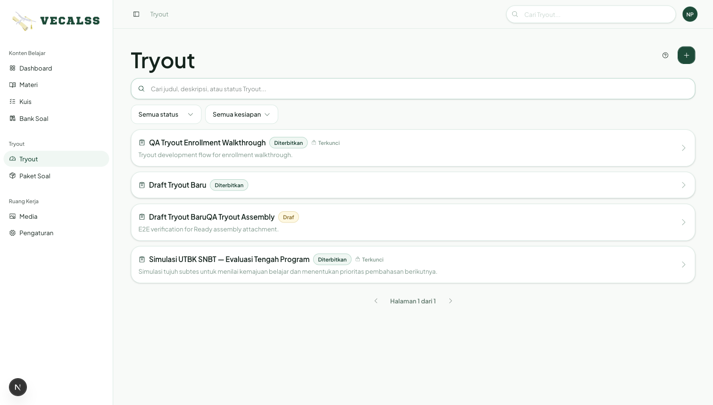
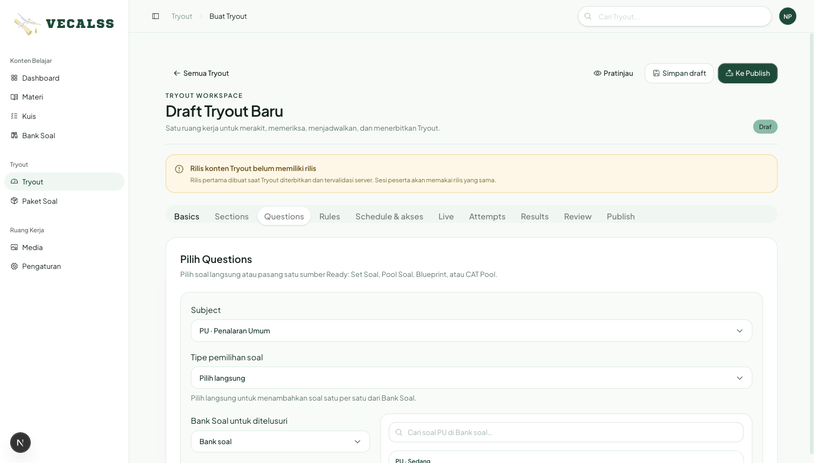
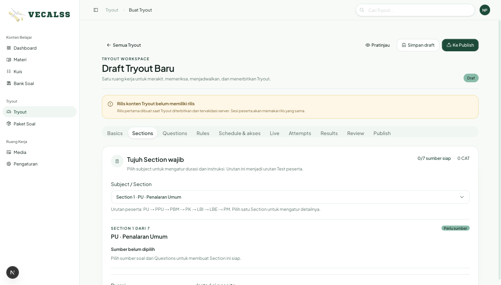
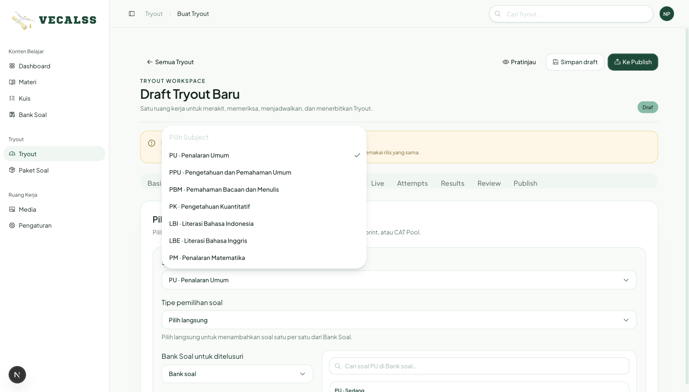
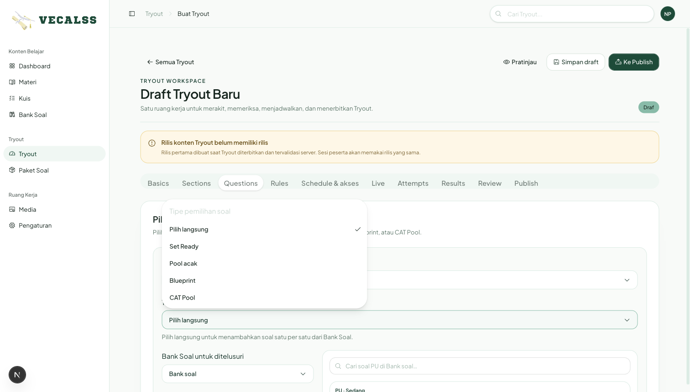
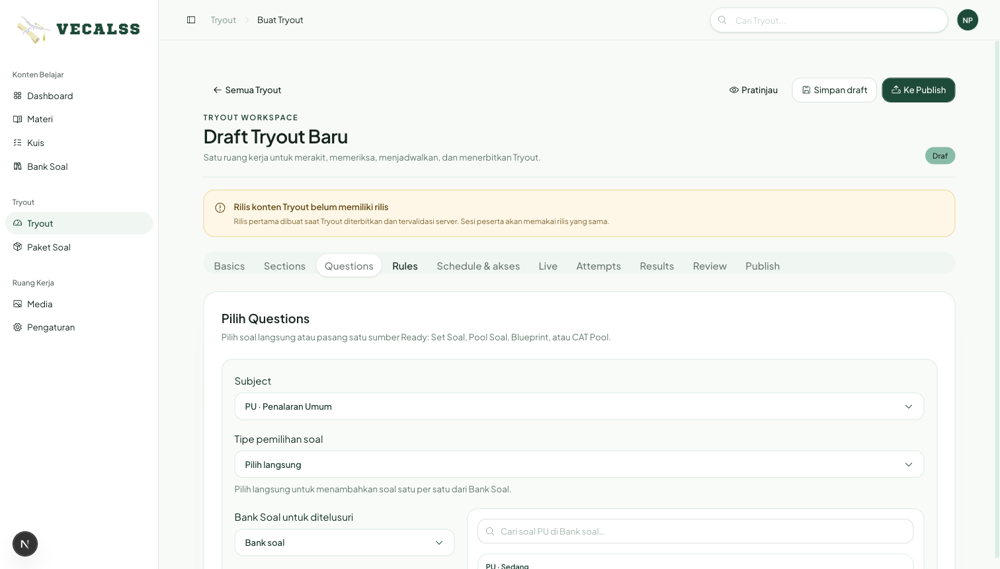
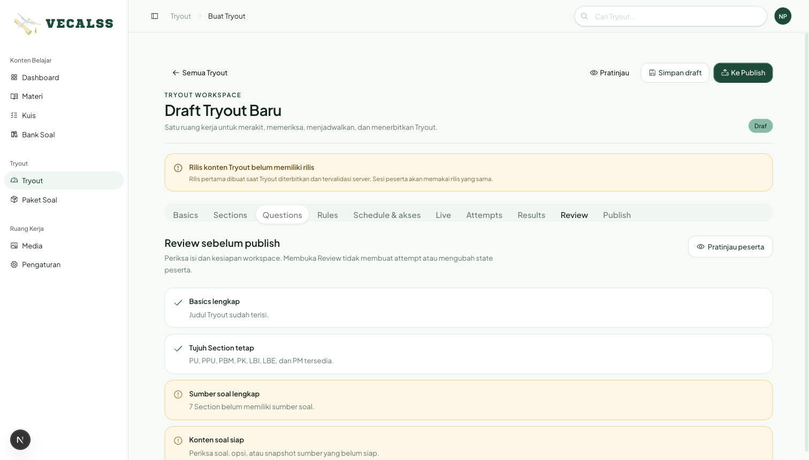
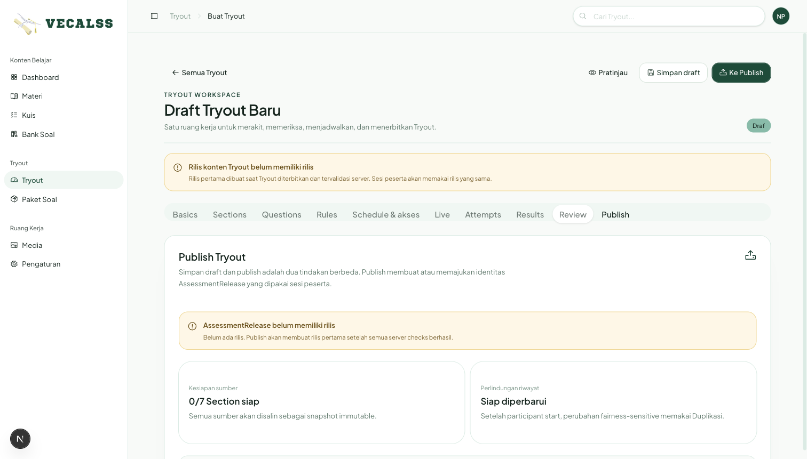
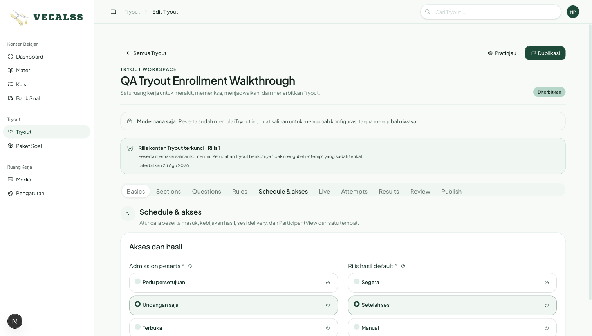
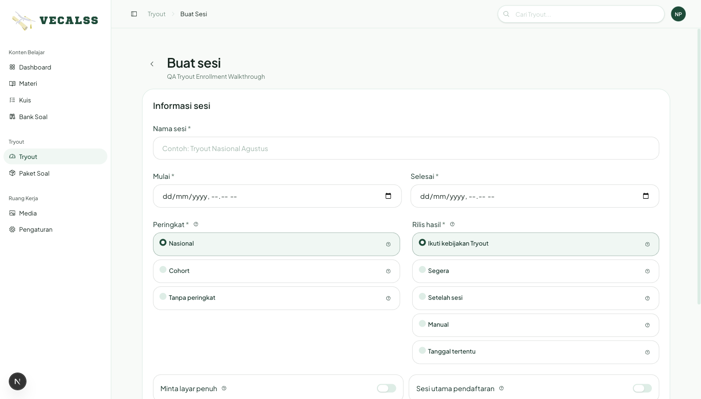

# Arsitektur Informasi dan Alur Tryout: dari Draf sampai Hasil

Panduan ini menjelaskan arsitektur informasi (IA) dan alur pengguna lengkap
untuk Kapten saat:

1. merakit Tryout,
2. menyimpan dan menerbitkan konten,
3. menyiapkan akses dan sesi peserta,
4. memantau pengerjaan secara live,
5. membuka detail attempt dan menangani pengecualian,
6. melihat hasil siswa dan mengatur rilis hasil, serta
7. memverifikasi pengalaman siswa sampai hasil dapat dilihat.

Dokumen ini juga menjadi panduan operasional, bukan hanya urutan pengisian
form. Gunakan istilah UI yang ditulis tebal sebagai nama area atau tombol di
produk.

> Perilaku yang dijelaskan mengikuti workspace Tryout yang berjalan pada
> 23 Agustus 2026. Screenshot authoring diambil dari alur mentor desktop pada
> tanggal yang sama. Jika screenshot lama berbeda dengan UI yang berjalan,
> perilaku UI dan status server terbaru menjadi sumber kebenaran.

## 1. Aktor dan hasil akhir

| Aktor | Tujuan utama | Keputusan yang dapat dibuat |
|---|---|---|
| **Kapten** | Membuat Tryout yang siap dipakai dan mengelola pelaksanaannya | Menyusun konten, menerbitkan rilis, membuat sesi, memberi akses, memantau, menghitung, menangani, dan merilis hasil |
| **Siswa** | Mengikuti sesi yang ditugaskan dan memahami hasilnya | Mendaftar atau membuka undangan, masuk ruang tunggu, mulai, menjawab, mengirim, dan meninjau hasil saat rilis mengizinkan |
| **Sistem** | Menjaga konsistensi konten, waktu, akses, scoring, dan audit | Mengunci snapshot, menjalankan timer server, menyinkronkan batas waktu, menahan hasil yang belum valid, dan menyegarkan proyeksi operasional |

Hasil akhir yang diharapkan bukan sekadar Tryout berstatus diterbitkan.
Sebuah pelaksanaan dianggap siap ketika:

- Tryout memiliki tujuh Section dengan sumber soal yang siap;
- **AssessmentRelease** sudah dibuat oleh publish;
- minimal satu sesi memiliki jendela waktu dan kebijakan yang jelas;
- peserta memiliki admission dan assignment sesi yang valid;
- Kapten dapat menemukan status peserta pada **Live**, **Attempts**, atau
  **Results**; dan
- siswa dapat masuk, menyelesaikan tujuh Test, dan melihat paket hasil sesuai
  kebijakan rilis.

## 2. Model mental singkat

Alur utama Tryout adalah:

**Bank Soal / sumber Ready → Tryout draf → Review → Publish →
AssessmentRelease → Schedule & akses → Sesi → Admission/assignment →
Attempt tujuh Test → Live/Attempts → Scoring → Rilis hasil →
Results Kapten dan hasil siswa**

Preview berada di samping alur utama. Preview boleh dibuka kapan saja untuk
memeriksa pengalaman peserta, tetapi tidak membuat admission, sesi, attempt,
atau hasil.

~~~mermaid
flowchart LR
  Source["Bank Soal / sumber Ready"] --> Draft["Tryout draf"]
  Draft --> Review["Review"]
  Review --> Publish["Publish"]
  Publish --> Release["AssessmentRelease\nsnapshot konten"]
  Release --> Schedule["Schedule & akses"]
  Schedule --> Session["Sesi delivery"]
  Session --> Access["Admission + assignment"]
  Access --> Waiting["Ruang tunggu siswa"]
  Waiting --> Attempt["Attempt\n7 Test / run"]
  Attempt --> Monitor["Live dan Attempts"]
  Attempt --> Score["Scoring"]
  Score --> ReleaseResult["Rilis hasil sesi"]
  ReleaseResult --> MentorResult["Results Kapten"]
  ReleaseResult --> StudentResult["Hasil siswa"]
  Draft -. "baca saja" .-> Preview["Pratinjau peserta"]
  Preview -. "tidak membuat state runtime" .-> Draft
~~~

## 3. Arsitektur informasi Tryout workspace

### 3.1 Area utama dan urutannya

Semua Tryout yang sudah memiliki ID dibuka sebagai satu **Tryout workspace**.
Workspace tersebut memiliki sepuluh area berikut:

| Area | Peran dalam IA | Kapan tersedia | Output atau next action |
|---|---|---|---|
| **Basics** | Identitas yang terlihat oleh Kapten dan siswa | Sejak halaman buat dibuka | Judul dan deskripsi |
| **Sections** | Struktur tetap tujuh subtest dan urutan pengerjaan | Sejak halaman buat dibuka | Durasi dan instruksi per Section |
| **Questions** | Sumber soal untuk setiap Section | Sejak halaman buat dibuka | Pilihan langsung atau satu sumber Ready per Section |
| **Rules** | Perilaku Test per Section | Sejak halaman buat dibuka | CBT/CAT, jumlah CAT, dan pengacakan |
| **Schedule & akses** | Kebijakan admission, rilis hasil, sesi, dan peserta | Setelah draf disimpan dan Tryout memiliki ID | Pelaksanaan siap menerima peserta |
| **Live** | Ringkasan posisi peserta saat pelaksanaan berlangsung | Setelah draf tersimpan; paling berguna saat ada attempt | Status peserta dan next action operasional |
| **Attempts** | Detail runtime tingkat attempt dan tujuh run | Setelah draf tersimpan; terisi setelah siswa mulai | Progress, timer, jawaban, sinyal, dan tindakan perbaikan |
| **Results** | Ringkasan kesiapan scoring, rilis, dan peringkat | Setelah draf tersimpan; terisi setelah ada attempt | Hasil per peserta dan jalur ke analisis atau rilis sesi |
| **Review** | Checklist kesiapan sebelum publish | Sejak halaman buat dibuka | Daftar blocker yang dapat dilengkapi |
| **Publish** | Tindakan high-impact untuk membuat rilis konten | Sejak halaman buat dibuka | Rilis pertama, rilis pembaruan, atau Duplikasi |

Urutan navigasi visual menempatkan area operasional sebelum **Review** dan
**Publish**, tetapi urutan kerja yang disarankan tetap:

**Basics → Sections → Questions → Rules → Simpan draft → Review →
Publish → Schedule & akses → Live/Attempts/Results**

### 3.2 Progressive disclosure sebelum draf tersimpan

Pada halaman **Buat Tryout**, Kapten dapat menyiapkan **Basics**, **Sections**,
**Questions**, **Rules**, **Review**, dan **Publish** secara lokal. Area
**Schedule & akses**, **Live**, **Attempts**, dan **Results** menampilkan pesan
bahwa draf harus disimpan terlebih dahulu.

Ini adalah batas informasi yang penting:

- mengisi field dan berpindah tab belum membuat Tryout di database;
- **Simpan draft** pertama kali membuat Tryout dan tujuh Section awal;
- setelah save berhasil, halaman berpindah ke Tryout dengan ID tersendiri;
- area operasional kemudian memuat data server yang sama, bukan salinan lokal;
- **Review** membantu navigasi, tetapi validasi server saat publish tetap
  menentukan berhasil atau tidaknya penerbitan.

### 3.3 Status yang perlu terlihat

Header workspace selalu menunjukkan:

- judul Tryout;
- status **Draf** atau **Diterbitkan**;
- tombol **Pratinjau**;
- tombol **Simpan draft** jika masih editable;
- **Ke Publish** untuk draf editable;
- **Duplikasi** jika Tryout sudah terkunci.

Jika sudah ada peserta yang memulai Tryout, workspace menjadi **Mode baca
saja**. Pesan tersebut harus dipahami sebagai perlindungan riwayat: buat
salinan editable untuk perubahan yang fairness-sensitive.

## 4. Objek dan batas informasi

Tryout menjadi mudah dipahami jika objek berikut tidak dicampur:

| Lapisan | Objek yang dilihat Kapten | Pertanyaan yang dijawab |
|---|---|---|
| **Sumber** | Bank Soal, soal Ready, Set Ready, Pool, Blueprint, CAT Pool | Soal apa yang tersedia untuk dirakit? |
| **Authoring** | Tryout, tujuh Section, Rules | Bentuk Tryout seperti apa? |
| **Rilis** | AssessmentRelease | Konten versi mana yang boleh dipakai peserta? |
| **Delivery** | Kebijakan, sesi, admission, assignment, ParticipantView | Siapa boleh masuk, kapan, dan pada sesi apa? |
| **Runtime** | Attempt, tujuh Test run, jawaban, timer, sinyal integritas | Apa yang terjadi saat siswa mengerjakan? |
| **Reporting** | Scoring, result release, ranking, analisis | Hasil mana yang sudah sah dan boleh dilihat? |

**AssessmentRelease** adalah batas konten yang tidak boleh dilewati. Session dan
attempt memakai snapshot rilis, bukan membaca Bank Soal yang mungkin berubah
setelah publish. Karena itu:

- Preview sumber hanya membaca readiness dan contoh soal;
- Publish membuat snapshot konten;
- sesi tidak boleh dibuka tanpa rilis yang valid;
- attempt baru mengikat kontennya ke rilis sesi;
- hasil tidak boleh membuka bundle jawaban atau kunci sebelum seluruh gate
  terpenuhi.

## 5. Peta hubungan informasi

~~~mermaid
flowchart TB
  Bank["Bank Soal"] --> Question["Soal Ready"]
  Question --> Source["Pilih langsung / Set / Pool / Blueprint / CAT Pool"]
  Source --> Section["Section subtest"]
  Section --> Tryout["Tryout tujuh Section"]
  Tryout --> Review["Review"]
  Review --> Release["AssessmentRelease"]
  Release --> Delivery["Sesi delivery"]
  Delivery --> Admission["Admission peserta"]
  Admission --> Assignment["Assignment ke sesi"]
  Assignment --> Participant["ParticipantView"]
  Participant --> Attempt["TryoutAttempt"]
  Attempt --> Run["Test run 1–7"]
  Run --> Answer["Jawaban dan timer"]
  Run --> Score["Scoring per Test"]
  Score --> Aggregate["Skor Tryout"]
  Aggregate --> Result["Result projection"]
  Delivery --> ResultPolicy["Kebijakan rilis hasil"]
  ResultPolicy --> Result
  Result --> Ranking["Peringkat"]
~~~

## 6. Flow A — masuk dari daftar Tryout

### Tujuan

Kapten menemukan draf atau Tryout terbit, lalu melanjutkan ke workspace yang
tepat.

### Langkah

1. Buka menu **Tryout** di sidebar.
2. Gunakan pencarian berdasarkan judul, deskripsi, atau status jika daftar
   panjang.
3. Filter berdasarkan **Draf** atau **Diterbitkan**.
4. Filter kesiapan berdasarkan **7/7 Paket terikat** atau **Paket belum
   lengkap**.
5. Pilih baris Tryout untuk membuka workspace.
6. Untuk objek baru, tekan **Buat Tryout** di kanan atas.

**Lokasi:** sidebar kiri → **Tryout** → **Buat Tryout**.

## 7. Flow B — membuat isi Tryout

### 7.1 Buka workspace dan pahami tindakan global

Pada halaman baru:

- **Pratinjau** membuka simulasi ringkas pengalaman peserta;
- **Simpan draft** membuat atau memperbarui Tryout;
- **Ke Publish** memindahkan Kapten ke area pemeriksaan/penerbitan;
- tab workspace mengubah konteks tampilan, bukan otomatis menyimpan.

### 7.2 Isi Basics

1. Isi **Judul Tryout**.
2. Isi **Deskripsi** yang membantu Kapten dan siswa mengenali simulasi.
3. Pastikan identitas tidak bergantung pada nama internal sumber soal.

Status pada tahap ini masih lokal sampai **Simpan draft** ditekan.

### 7.3 Atur tujuh Section

Tryout memiliki tujuh Section tetap dalam urutan:

**PU → PPU → PBM → PK → LBI → LBE → PM**

Untuk setiap Section:

1. buka dropdown **Subject / Section**;
2. pilih subtest;
3. atur **Durasi** dalam menit;
4. isi **Instruksi peserta**;
5. lanjutkan ke Section berikutnya.

Urutan ini adalah urutan yang akan dilihat siswa. Dropdown hanya mengganti
Section yang sedang diedit; tidak membuat Section baru.

### 7.4 Pilih sumber soal

Pada **Questions**:

1. pilih **Subject** yang ingin diisi;
2. pilih **Tipe pemilihan soal**;
3. pastikan sumber sesuai dengan subtest aktif;
4. buka **Preview** bila perlu;
5. kembali ke Review setelah semua Section memiliki sumber.

| Tipe pemilihan soal | Mental model | Cara kerja dan perhatian |
|---|---|---|
| **Pilih langsung** | Kapten menyusun daftar soal satu per satu | Pilih **Bank Soal**, cari soal Ready, tekan **Tambah ke Section**, lalu periksa urutan. Soal yang sama tidak boleh muncul dua kali dalam Tryout. |
| **Set Ready** | Gunakan kumpulan tetap yang sudah siap | Pasang satu Set untuk Section. Isi Set sudah memiliki identitas versi dan snapshot yang siap ditinjau. |
| **Pool acak** | Tetapkan kandidat, biarkan sistem mengambil sejumlah soal | Tentukan sumber Pool dan jumlah yang diambil. Preview hanya contoh; bentuk final dipastikan saat rilis dibuat. |
| **Blueprint** | Tetapkan kuota berdasarkan tingkat kesulitan | Isi kuota **Mudah**, **Sedang**, dan **Sulit**. Kekurangan pada satu tingkat tidak boleh diam-diam diganti dari tingkat lain. |
| **CAT Pool** | Gunakan kumpulan soal adaptif yang terkalibrasi | Hanya cocok untuk Test **CAT**. Kandidat dan kalibrasi 2PL harus siap, dan jumlah kandidat harus cukup untuk jumlah soal yang dikirim. |

#### Pilih langsung

1. Pilih **Bank Soal** pada panel sumber.
2. Gunakan pencarian judul, folder, kategori, atau soal.
3. Buka soal yang sesuai dengan subtest aktif.
4. Tekan **Tambah ke Section**.
5. Periksa daftar **Soal terpilih**.
6. Gunakan kontrol naik/turun untuk mengatur urutan.
7. Hapus soal bila duplikat atau tidak lagi sesuai.

#### Sumber Ready

1. Pilih **Set Ready**, **Pool acak**, **Blueprint**, atau **CAT Pool**.
2. Cari nama sumber.
3. Periksa badge **Ready** atau **Ada blocker**.
4. Baca jumlah kandidat, kuota, Bank Soal, dan pesan readiness.
5. Tekan **Pasang sumber**.
6. Tekan **Preview** atau **Lihat preview dan kesiapan** untuk melihat contoh
   soal dan blocker.

Preview sumber tidak membuat versi baru, TryoutItem, rilis, sesi, attempt, atau
CAT run. Jika berpindah dari daftar soal langsung ke sumber Ready, daftar soal
langsung pada Section itu dilepas secara lokal; simpan hanya setelah pilihan
tersebut benar.

### 7.5 Atur Rules

Pada **Rules**, periksa setiap Section:

1. pilih **CBT** atau **CAT**;
2. jika CAT, isi **Jumlah soal CAT**;
3. atur **Acak urutan soal**;
4. kembali ke Questions jika mode sumber tidak cocok dengan tipe Test.

Aturan kompatibilitas penting:

- **CAT Pool** hanya dapat dipakai pada Test CAT;
- Set, Pool, dan Blueprint yang bukan CAT hanya dapat dipakai pada Test CBT;
- CAT membutuhkan pool cukup dan kalibrasi 2PL siap;
- validasi UI membantu orientasi, tetapi server memeriksa ulang saat save dan
  publish.

### 7.6 Gunakan Pratinjau peserta

Tekan **Pratinjau** dari header atau **Pratinjau peserta** pada Review.
Pratinjau menampilkan:

- judul dan deskripsi Tryout;
- urutan tujuh Test;
- durasi setiap Section;
- ringkasan sumber soal atau jumlah soal langsung.

Pratinjau membaca draf saat ini. Ia tidak membuat:

- admission;
- assignment;
- delivery session;
- attempt;
- jawaban;
- AssessmentRelease; atau
- hasil.

## 8. Flow C — simpan, review, dan publish

### 8.1 Simpan draf

Tekan **Simpan draft** setelah isi cukup lengkap. Ada dua lokasi:

- tombol global di kanan atas;
- tombol **Simpan draft** pada area **Publish**.

Save pertama kali:

1. memvalidasi input dasar di server;
2. membuat Tryout dan tujuh Section awal;
3. menyimpan sumber yang dipilih;
4. memberi Tryout ID;
5. memuat area Schedule & akses, Live, Attempts, dan Results.

Save berikutnya memperbarui draf tanpa membuat AssessmentRelease baru. Jika
hasil save pertama berhasil, halaman membuka URL edit dan memilih **Review**
agar blocker langsung terlihat.

### 8.2 Periksa Review

**Review** adalah daftar pemeriksaan yang membawa Kapten ke sumber masalah.
Pemeriksaan yang saat ini perlu lulus meliputi:

| Pemeriksaan | Arti bagi Kapten |
|---|---|
| **Basics lengkap** | Judul Tryout sudah ada |
| **Tujuh Section tetap** | PU, PPU, PBM, PK, LBI, LBE, dan PM tersedia |
| **Sumber soal lengkap** | Setiap Section memiliki soal langsung atau satu sumber Ready |
| **Konten soal siap** | Snapshot, prompt, opsi, dan source identity dapat dipakai |
| **Penjelasan & media siap** | Pembahasan dan media yang dibutuhkan sudah siap |
| **Assembly siap dirilis** | Pool, Blueprint, CAT Pool, atau Set tidak memiliki blocker readiness |
| **Sumber soal unik** | Tidak ada sumber soal yang sama di lebih dari satu tempat |
| **CAT & 2PL siap** | Jumlah CAT cukup dan kalibrasi valid |
| **Mode assembly sesuai Test** | Mode sumber tidak bertentangan dengan CBT/CAT |
| **Durasi valid** | Semua Section memiliki durasi positif |
| **Schedule & akses** | Jendela sesi tidak konflik; sesi dapat dibuat setelah Tryout diterbitkan |

Jika ada blocker:

1. tekan **Lengkapi** di samping Section yang disebut;
2. perbaiki Questions, Sections, atau Rules;
3. kembali ke Review;
4. ulangi sampai tidak ada pemeriksaan gagal.

Review tidak membuat attempt dan tidak mengubah state peserta.

### 8.3 Publish

Pada **Publish**:

1. baca jumlah Section siap;
2. pastikan Review tidak memiliki blocker;
3. tekan **Terbitkan Tryout**;
4. baca dialog konfirmasi;
5. konfirmasi tindakan.

Perbedaan tindakan:

| Tindakan | Makna |
|---|---|
| **Simpan draft** | Menyimpan konfigurasi editable; tidak membuat rilis peserta |
| **Terbitkan Tryout** | Membuat AssessmentRelease pertama dan snapshot konten immutable |
| **Terbitkan pembaruan** | Membuat rilis baru bila isi berubah; sesi yang sudah terbuka tetap memakai rilis sebelumnya |
| **Duplikasi** / **Buat salinan editable** | Membuat draf baru tanpa mengubah riwayat peserta atau rilis lama |

Sesi peserta tidak boleh dibuka sebelum ada AssessmentRelease. Setelah publish,
buka **Schedule & akses** untuk membuat sesi.

## 9. Flow D — Schedule & akses

**Schedule & akses** menyatukan tiga pertanyaan operasional:

1. siapa yang boleh masuk;
2. kapan peserta dapat masuk; dan
3. kapan hasil boleh dilihat.

### 9.1 Atur kebijakan Tryout

Pada bagian kebijakan, pilih:

#### Admission peserta

| Pilihan | Perilaku |
|---|---|
| **Terbuka** | Siswa dapat mendaftar dan memperoleh admission aktif tanpa persetujuan manual |
| **Perlu persetujuan** | Pendaftaran menunggu keputusan Kapten |
| **Undangan saja** | Hanya siswa yang diundang Kapten yang dapat memperoleh akses |

#### Rilis hasil default

| Pilihan | Perilaku |
|---|---|
| **Segera** | Hasil dibuka setelah perhitungan lengkap; peringkat dapat bersifat sementara sampai sesi selesai |
| **Setelah sesi** | Hasil dibuka setelah waktu sesi berakhir dan perhitungan lengkap |
| **Manual** | Hasil tetap tertutup sampai Kapten merilis sesi |

1. Pilih **Admission peserta**.
2. Pilih **Rilis hasil default**.
3. Isi **Alasan audit**.
4. Tekan **Simpan kebijakan**.

Alasan audit wajib diisi karena perubahan kebijakan adalah tindakan operasional
yang perlu dapat dijelaskan kembali.

### 9.2 Buat sesi delivery

Pada bagian **Sesi**, tekan **Buat sesi** dan isi:

1. **Nama sesi**, misalnya “Tryout Nasional Agustus”;
2. **Mulai**;
3. **Selesai**;
4. **Peringkat**: Nasional, Cohort, atau Tanpa peringkat;
5. **Rilis hasil**:
   - Ikuti kebijakan Tryout,
   - Segera,
   - Setelah sesi,
   - Manual, atau
   - Tanggal tertentu;
6. **Waktu rilis hasil** jika memilih Tanggal tertentu;
7. **Minta layar penuh** bila ingin meminta siswa masuk fullscreen;
8. **Sesi utama pendaftaran** bila sesi ini menjadi sesi default untuk
   pendaftaran terbuka;
9. **Alasan perubahan**.

Tekan **Simpan draft** pada bagian bawah form.

Aturan waktu:

- **Mulai** sebaiknya masih akan datang ketika siswa belum boleh masuk;
- **Selesai** harus cukup panjang untuk seluruh durasi tujuh Test dan toleransi
  keterlambatan;
- waktu rilis terjadwal tidak boleh lebih awal dari waktu sesi selesai;
- setelah **Selesai** lewat, siswa tidak dapat memulai sesi tersebut;
- sesi dapat dibuka dari detail sesi setelah AssessmentRelease valid;
- hanya satu sesi aktif yang boleh menjadi sesi utama open registration.

### 9.3 Undang atau atur peserta

Pada bagian **Peserta**, gunakan **Undang peserta**:

1. ketik minimal dua karakter nama tampilan;
2. pilih siswa dari daftar;
3. pilih **Sesi Tryout** yang aktif, sudah memiliki rilis, dan belum berakhir;
4. isi **Alasan audit**;
5. tekan **Kirim undangan**.

Email dan metadata akun tidak ditampilkan pada picker. Setelah undangan:

- daftar peserta dimuat ulang dari state server;
- siswa menerima notifikasi undangan;
- siswa memperoleh tautan ke ruang tunggu;
- assignment aktif menjadi syarat masuk;
- pengiriman ulang undangan aktif yang sama bersifat idempotent dan tidak
  membuat notifikasi ganda;
- setelah akses dicabut lalu diundang lagi, notifikasi baru dapat dibuat.

### 9.4 Kelola satu peserta

Tekan baris peserta untuk membuka **Detail Peserta**. Halaman ini merangkum:

- Admission;
- sesi dan status sesi;
- attempt;
- nilai dan rilis.

Tindakan yang tersedia bergantung pada state:

| State | Tindakan |
|---|---|
| Admission menunggu | **Setujui** atau **Tolak**; dapat memilih sesi saat menyetujui |
| Admission aktif tanpa sesi | **Tugaskan sesi** |
| Assignment aktif | **Cabut akses** |
| Semua tindakan | Wajib **Alasan audit** dan konfirmasi |

Mencabut akses tidak menghapus riwayat attempt. Peserta yang sudah mulai tetap
memiliki riwayat runtime untuk audit dan result gate.

## 10. Flow E — siswa masuk dan mulai

### 10.1 Dari undangan atau katalog

Siswa dapat sampai ke Tryout melalui katalog atau notifikasi undangan. Pada
detail Tryout, aksi utama berubah sesuai state:

| Kondisi siswa | Aksi utama |
|---|---|
| Belum mendaftar pada Tryout terbuka | **Daftar tryout** |
| Admission menunggu | Melihat pesan **Menunggu persetujuan** |
| Admission aktif tetapi belum ada sesi | Melihat pesan **Menunggu jadwal sesi** |
| Assignment aktif dan belum mulai | **Mulai** |
| Attempt masih berjalan | **Lanjutkan ujian** |
| Attempt selesai | **Lihat hasil** atau menunggu rilis |
| Akses dicabut / ditolak | Melihat alasan status dan kembali mencari pilihan lain |

### 10.2 Ruang tunggu

Ruang tunggu menampilkan:

- judul Tryout;
- waktu mulai;
- batas akhir;
- panduan koneksi stabil;
- penjelasan bahwa jawaban tersimpan otomatis;
- penjelasan bahwa timer server terus berjalan setelah reload atau berpindah
  aplikasi;
- perbedaan navigasi CBT dan CAT;
- penjelasan bahwa sinyal fokus, tab, dan fullscreen adalah peringatan tanpa
  penalti otomatis.

Tombol **Mulai** hanya aktif ketika:

- assignment aktif;
- waktu sekarang sudah berada di antara Mulai dan Selesai; dan
- sesi memiliki konten yang dapat dipakai.

Saat **Mulai** berhasil, sistem membuat satu attempt dan tujuh Test run
pending. Siswa diarahkan ke attempt, bukan sekadar membaca halaman detail.

## 11. Flow F — Live monitoring

### Tujuan

Kapten dapat mengetahui siapa yang belum mulai, sedang mengerjakan, selesai,
atau membutuhkan pemeriksaan tanpa membuka detail setiap siswa satu per satu.

### 11.1 Masuk ke Live

1. Buka Tryout yang sudah disimpan.
2. Pilih tab **Live**.
3. Periksa jumlah peserta terpantau, waktu refresh terakhir, dan banner
   AssessmentRelease.
4. Gunakan kartu status untuk memahami distribusi keadaan.
5. Buka **Participant** untuk masalah akses atau **Buka attempt** untuk
   masalah runtime.

Live tidak menampilkan bundle soal atau kunci jawaban. Ia adalah proyeksi
operasional yang aman untuk orientasi dan next action.

### 11.2 Status Live

| Status Live | Arti bagi Kapten | Next action |
|---|---|---|
| **Terdaftar** | Siswa terdaftar, tetapi belum memiliki attempt; dapat menunggu keputusan atau penugasan | Buka **Schedule & akses** atau detail Participant |
| **Sudah check-in** | Attempt sudah dibuat, tetapi belum ada Test yang aktif | Tunggu atau buka attempt untuk memastikan transisi |
| **Berlangsung** | Siswa sedang mengerjakan Test aktif | Pantau timer dan progress dari Attempts |
| **Terputus** | Marker disconnect lifecycle aktif dan belum direkonsiliasi | Buka detail attempt; verifikasi lalu gunakan tindakan disconnect berwenang |
| **Perlu perhatian** | Ada sinyal integritas, scoring review, atau batas waktu yang perlu diperiksa | Buka Participant atau Attempt; jangan mengambil penalti otomatis |
| **CAT gagal** | Run CAT gagal atau membutuhkan resolusi | Buka attempt; tinjau alasan, coba lagi CAT, atau void sesuai kasus |
| **Terkirim** | Attempt sudah terminal atau berakhir dan menunggu/masuk tahap hasil | Buka Attempts atau Results |

Satu peserta dapat berpindah status. Status terminal **Terkirim** menang atas
marker lama yang tidak lagi relevan.

### 11.3 Apa yang dipantau pada kartu peserta

Setiap kartu dapat menunjukkan:

- nama tampilan peserta;
- nama sesi;
- severity **Normal**, **Perlu ditinjau**, atau **Butuh tindakan**;
- alasan status;
- waktu marker disconnect dimulai dan direkonsiliasi bila ada;
- jumlah sinyal integritas;
- tautan **Participant**;
- tautan **Buka attempt** jika attempt tersedia.

### 11.4 Refresh dan batasan realtime

Live menggunakan refresh berkala yang terlihat oleh Kapten:

- saat tab terlihat, refresh otomatis berjalan setiap 15 detik;
- ketika tab kembali terlihat, refresh dipicu kembali;
- refresh yang sedang berlangsung tidak ditumpuk;
- setelah tiga kegagalan otomatis berturut-turut, refresh otomatis berhenti;
- pesan error meminta Kapten menekan **Coba lagi** atau **Refresh** secara
  manual;
- refresh manual mengatur ulang penghitung kegagalan;
- waktu **Terakhir diperbarui** membantu Kapten menilai kesegaran data.

Refresh tidak mengubah konten, kebijakan, atau rilis. Namun, server dapat
menyinkronkan state yang memang sudah melewati batas waktu ketika Live dibuka
atau di-refresh:

- Test yang melewati deadline dapat diseal atau kedaluwarsa;
- attempt yang melewati batas sesi dapat disubmit otomatis atau ditandai
  kedaluwarsa;
- marker disconnect dapat ditutup pada batas waktu server;
- perubahan tersebut meninggalkan audit dan tidak mengubah skor atau rilis
  secara diam-diam.

### 11.5 Sinyal integritas bukan penalti otomatis

Fokus keluar, tab tidak terlihat, dan keluar dari fullscreen adalah sinyal untuk
review manusia. Sinyal tersebut tidak otomatis:

- mengurangi skor;
- mencabut admission;
- membatalkan attempt;
- mem-void run;
- memblokir hasil.

Status **Terputus** hanya berasal dari marker lifecycle server. Ia tidak boleh
disimpulkan dari timer browser, event fokus, atau asumsi Kapten. Tindakan
memulai dan merekonsiliasi disconnect membutuhkan otorisasi dan alasan audit.

## 12. Flow G — melihat dan menangani Attempts

### 12.1 Daftar Attempts

Tab **Attempts** dipakai ketika Kapten membutuhkan detail runtime, bukan hanya
status singkat Live. Halaman ini menampilkan:

- jumlah total attempt;
- jumlah **Berlangsung**;
- jumlah **Perlu perhatian**;
- jumlah **Terkirim**;
- filter **Semua**, **Berlangsung**, **Terputus**, **Perlu perhatian**,
  **CAT gagal**, dan **Terkirim**.

Setiap kartu attempt menampilkan:

- siswa dan sesi;
- state attempt;
- progress tujuh Test;
- jawaban tersimpan dibanding jumlah soal;
- timer Test yang sedang aktif;
- status setiap run;
- jumlah sinyal integritas;
- state atau alasan kegagalan CAT;
- status rilis dan peringkat.

### 12.2 Trail integritas dan CAT

Jika ada event, kartu menampilkan **Trail integritas** berisi event terbaru:

- Fokus keluar / fokus kembali;
- Layar penuh masuk / keluar;
- Tab tidak terlihat / terlihat;
- waktu event menurut server.

Jika ada resolusi adaptif, kartu menampilkan **Resolusi CAT** dan alasan
tindakan. Kedua blok ini adalah konteks review, bukan vonis otomatis.

### 12.3 Detail attempt

Tekan **Buka detail** untuk melihat:

- banner konten rilis;
- skor indeks internal jika sudah dihitung;
- tujuh Test;
- status setiap run;
- state CAT;
- jumlah sinyal integritas;
- tindakan attempt.

Tindakan yang mungkin tersedia:

| Tindakan | Kapan digunakan | Syarat |
|---|---|---|
| **Hitung hasil** | Semua run sudah cukup lengkap atau perlu scoring | Alasan audit |
| **Coba lagi CAT** | Run CAT berada pada state gagal dan dapat diulang | Alasan audit |
| **Void CAT** | Run CAT harus dikeluarkan dari perhitungan | Alasan audit dan konfirmasi; dapat memblokir rilis |
| **Mulai disconnect** | Operator memastikan Test aktif benar-benar terputus | Run aktif dan alasan audit |
| **Rekonsiliasi disconnect** | Operator menutup marker setelah verifikasi | Marker aktif, run yang sama, dan alasan audit |

Setelah tindakan berhasil, halaman melakukan refresh dari server. Jangan
menyimpulkan bahwa skor atau rilis berubah sebelum state baru terlihat.

## 13. Flow H — melihat hasil siswa dan rilis hasil

### 13.1 Results sebagai ringkasan Kapten

Tab **Results** menjawab empat pertanyaan berbeda:

1. berapa attempt sudah dinilai;
2. berapa yang perlu review;
3. berapa hasil sudah dirilis;
4. berapa peserta sudah memiliki peringkat.

Kartu ringkasan menampilkan:

- **Sudah dinilai**;
- **Perlu review**;
- **Hasil dirilis**;
- **Peringkat tersedia**.

Jangan menggabungkan empat angka tersebut menjadi satu angka “selesai”.
Scoring, release, dan ranking adalah sumbu yang berbeda.

### 13.2 Cara membaca satu hasil peserta

Pada kartu sesi, setiap peserta memiliki status:

| Sumbu | Label yang mungkin | Makna |
|---|---|---|
| **Kesiapan hasil** | Belum mulai, Menunggu penilaian, Perlu review, Sudah dinilai | Apakah attempt sudah menghasilkan scoring yang dapat dipercaya |
| **Rilis** | Tersembunyi, Terjadwal, Dirilis | Apakah paket hasil sudah boleh dilihat |
| **Peringkat** | Peringkat tersedia, Peringkat menunggu rilis, Peringkat tidak tersedia | Apakah posisi dapat dihitung dan ditampilkan |

Skor hanya ditampilkan jika:

- attempt sudah terminal;
- tujuh run dan breakdown scoring valid;
- tidak ada blocker review atau CAT yang belum terselesaikan;
- AssessmentRelease attempt cocok dengan rilis sesi; dan
- result release mengizinkan skor terlihat.

Jika salah satu gate belum terpenuhi, Kapten melihat **Skor ditahan** dan alasan
review bila ada. Workspace tidak mengirim bundle hasil parsial, kunci, atau
konten embargo hanya karena kartu Results dibuka.

Pada setiap baris, Kapten dapat:

- membuka **Participant** untuk status akses dan sesi;
- membuka **Analisis** untuk detail attempt;
- membuka **Detail sesi** untuk tindakan rilis dan validasi bundle lengkap.

### 13.3 Kebijakan rilis per sesi

| Kebijakan sesi | Kapan hasil peserta dapat dibuka |
|---|---|
| **Ikuti kebijakan Tryout** | Mengikuti default Tryout |
| **Segera** | Setelah scoring lengkap; ranking dapat sementara sampai sesi selesai |
| **Setelah sesi** | Setelah waktu sesi berakhir dan scoring lengkap |
| **Manual** | Setelah Kapten menekan **Rilis hasil** pada detail sesi |
| **Tanggal tertentu** | Otomatis pada waktu yang dipilih, tidak lebih awal dari akhir sesi, setelah scoring valid |

### 13.4 Rilis manual dari detail sesi

Jika kebijakan efektif adalah **Manual**:

1. buka **Detail sesi**;
2. periksa daftar **Attempt peserta**;
3. buka tab **Detail & tindakan**;
4. pastikan AssessmentRelease tersedia;
5. isi **Alasan perubahan**;
6. tekan **Rilis hasil**;
7. konfirmasi.

Jika kebijakan bukan Manual, tombol rilis manual tidak ditampilkan sebagai
tindakan utama. Jika ada attempt yang perlu review, selesaikan dari detail
attempt sebelum mencoba rilis.

## 14. Flow I — siswa melihat hasil

Alur hasil di sisi siswa:

~~~mermaid
flowchart LR
  Submit["Siswa mengirim attempt"] --> Processing["Memeriksa jawaban\nmenghitung skor"]
  Processing --> Gate{"Rilis diizinkan?"}
  Gate -- "Belum" --> Held["Hasil tersimpan\nHasil belum dibuka"]
  Held --> Retry["Periksa lagi"]
  Gate -- "Ya" --> Result["Hasil Tryout"]
  Result --> Summary["Skor, akurasi,\nbenar/salah/kosong"]
  Result --> Sections["Analisis per Section"]
  Result --> Review["Review soal,\njawaban, dan pembahasan"]
  Result --> Rank["Peringkat bila tersedia"]
~~~

Saat attempt selesai, siswa dapat melihat halaman transisi:

- **Tryout masih berjalan** jika masih ada pekerjaan yang dapat dilanjutkan;
- **Tryout sudah selesai** jika attempt terminal;
- tombol **Lanjutkan ujian** atau **Lihat hasil** sesuai keadaan.

Jika hasil belum dirilis, siswa melihat:

- status **Hasil tersimpan**;
- judul **Hasil belum dibuka**;
- penjelasan dari kebijakan rilis;
- tombol **Periksa lagi**;
- tombol kembali ke katalog Tryout.

Jika hasil sudah dirilis, paket hasil siswa memuat:

- **Skor Akhir**;
- target universitas dan jurusan bila tersedia;
- jumlah benar, salah, kosong, akurasi, dan rata-rata waktu;
- peringkat nasional atau kelompok bila diaktifkan dan tersedia;
- peringatan jika peringkat masih sementara;
- ringkasan per tujuh Section;
- penanda soal benar, salah, atau tidak dijawab;
- jawaban siswa;
- jawaban benar;
- pembahasan dan media penjelasan;
- aksi **Laporkan soal**.

Skor Tryout ditampilkan sebagai hasil latihan dan diberi disclaimer bahwa ia
bukan nilai resmi SNBT.

## 15. Keadaan dan cabang penting

### 15.1 Siklus authoring

| State | Kapten dapat melakukan | Kapten tidak dapat melakukan |
|---|---|---|
| Belum disimpan | Mengisi field, berpindah area, membuka preview, membuka Review | Mengatur sesi, mengundang, memantau, atau melihat hasil server |
| Draf | Mengubah isi, save, Review, publish | Membuka sesi tanpa AssessmentRelease |
| Diterbitkan dan belum terkunci | Meninjau rilis, publish pembaruan bila diperbolehkan | Mengubah rilis yang sudah dipakai sesi seolah-olah rilis lama berubah |
| Terkunci setelah peserta mulai | Membaca, memantau, melihat result, membuat duplikasi | Mengubah konten fairness-sensitive di tempat |

### 15.2 Siklus akses

| Admission | Assignment | Pengalaman siswa |
|---|---|---|
| Menunggu persetujuan | Belum ada | Menunggu keputusan Kapten |
| Aktif | Belum ada | Menunggu jadwal sesi |
| Aktif | Aktif | Dapat masuk ruang tunggu sesuai jendela |
| Ditolak | Tidak ada | Tidak dapat memperoleh akses |
| Dicabut | Dicabut | Tidak dapat memulai sesi; riwayat tetap ada |

### 15.3 Siklus attempt dan result

| Sumbu | State penting | Arti |
|---|---|---|
| Attempt | In progress, Submitted, Auto-submitted, Expired, Void, Scored | Apa yang terjadi terhadap eksekusi siswa |
| Scoring | Menunggu penilaian, Sudah dinilai, Perlu review | Apakah hasil perhitungan dapat dipercaya |
| Release | Tersembunyi, Terjadwal, Dirilis | Apakah paket hasil boleh dibaca siswa |
| Ranking | Tersedia, Menunggu rilis, Tidak tersedia | Apakah posisi dapat ditampilkan |

### 15.4 Penanganan cabang

| Situasi | Respons yang benar |
|---|---|
| Review menampilkan Section tanpa sumber | Lengkapi Questions; jangan publish sambil mengandalkan sesi |
| CAT memiliki kandidat kurang | Perbaiki CAT Pool atau jumlah soal; tidak ada fallback diam-diam |
| Assembly tidak cocok dengan tipe Test | Ubah Rules atau pilih sumber kompatibel |
| Sesi belum memiliki rilis | Publish Tryout sebelum membuka sesi |
| Siswa tidak dapat mulai | Periksa admission, assignment, waktu, status sesi, dan AssessmentRelease |
| Live tidak segar | Periksa waktu terakhir update; tekan Refresh manual setelah auto-refresh berhenti |
| Sinyal integritas muncul | Buka detail untuk review manusia; jangan otomatis memberi penalti |
| Disconnect aktif | Verifikasi run yang menjadi origin; rekonsiliasi dengan alasan audit |
| CAT gagal | Buka Attempt; pilih Coba lagi CAT atau Void CAT sesuai hasil review |
| Skor ditahan | Periksa result readiness, review reason, tujuh run, dan kebijakan rilis |
| Ranking tidak tersedia | Periksa rule sesi, jumlah attempt eligible, dan state release |
| Tryout terkunci | Buat salinan editable; jangan menimpa riwayat peserta |

## 16. Batas tindakan yang mengubah data

| Tindakan | Mengubah data? | Catatan |
|---|---:|---|
| Berpindah tab | Tidak | Mengubah konteks workspace saja |
| Membuka Preview peserta | Tidak | Tidak membuat admission, sesi, attempt, atau hasil |
| Melihat Preview sumber Ready | Tidak | Readiness dan sample bersifat ilustratif |
| Mengisi Basics/Sections/Questions/Rules sebelum save | Belum | Perubahan masih lokal |
| **Simpan draft** Tryout | Ya | Membuat atau memperbarui Tryout |
| **Terbitkan Tryout** | Ya | Membuat AssessmentRelease immutable |
| **Terbitkan pembaruan** | Ya | Membuat rilis baru bila isi berubah |
| **Duplikasi** | Ya | Membuat Tryout draf baru; rilis lama tetap |
| **Simpan kebijakan** | Ya | Mengubah admission dan default result release |
| **Buat sesi** | Ya | Membuat sesi delivery draf |
| **Buka sesi** | Ya | Mengaktifkan jendela delivery |
| **Kirim undangan** | Ya | Membuat atau mengaktifkan admission/assignment dan notifikasi |
| **Setujui/Tolak** admission | Ya | Mengubah akses peserta dan audit |
| **Tugaskan sesi/Cabut akses** | Ya | Mengubah assignment; riwayat tidak dihapus |
| Refresh **Live** | Biasanya baca | Dapat menyinkronkan deadline server yang memang sudah lewat |
| **Hitung hasil** | Ya | Menjalankan atau memperbarui state scoring |
| **Coba lagi CAT** | Ya | Menyiapkan ulang run CAT dengan audit |
| **Void CAT** | Ya | Mengeluarkan run dari perhitungan; dapat menahan rilis |
| Mulai/Rekonsiliasi disconnect | Ya | Menulis marker lifecycle dan audit |
| **Rilis hasil** | Ya | Membuka paket hasil sesi bagi peserta |
| Siswa **Mulai** | Ya | Membuat attempt dan tujuh run |
| Siswa menyimpan jawaban | Ya | Menyimpan state jawaban runtime |
| Siswa mengirim Test/attempt | Ya | Menutup run atau attempt dan memulai jalur scoring |

## 17. Peta navigasi dan deep link

### Kapten

| Tujuan | Lokasi |
|---|---|
| Daftar Tryout | **/mentor/tryout** |
| Buat Tryout | **/mentor/tryout/create** |
| Workspace Tryout | **/mentor/tryout/{tryoutId}** |
| Area workspace | **/mentor/tryout/{tryoutId}?workspace=basics**, **sections**, **questions**, **rules**, **schedule**, **live**, **attempts**, **results**, **review**, atau **publish** |
| Buat sesi | **/mentor/tryout/{tryoutId}/operations/sessions/new** |
| Detail sesi | **/mentor/tryout/{tryoutId}/operations/sessions/{sessionId}** |
| Detail peserta | **/mentor/tryout/{tryoutId}/operations/participants/{admissionId}** |
| Detail attempt | **/mentor/tryout/{tryoutId}/operations/attempts/{attemptId}** |

URL lama untuk operations, policy, sessions, dan participants tetap diterima
sebagai bookmark dan diarahkan ke tab workspace yang sesuai. Gunakan nama area
workspace dalam dokumentasi dan link baru agar pengguna tidak merasa berpindah
produk.

### Siswa

| Tujuan | Lokasi |
|---|---|
| Katalog Tryout | **/tryout** |
| Detail Tryout | **/tryout/{tryoutId}** |
| Pendaftaran | **/tryout/{tryoutId}/register** |
| Ruang tunggu | **/tryout/{tryoutId}/waiting** |
| Attempt aktif | **/tryout/attempt/{attemptId}** |
| Hasil attempt | **/tryout/attempt/{attemptId}/result** |

## 18. Checklist operasional

### Sebelum publish

- [ ] Judul dan deskripsi sudah benar.
- [ ] Tujuh Section tetap tersedia dan urutannya benar.
- [ ] Semua Section memiliki sumber soal.
- [ ] Sumber langsung atau Ready sesuai dengan subtest.
- [ ] Tidak ada soal sumber duplikat.
- [ ] Prompt, opsi, penjelasan, dan media siap.
- [ ] CBT/CAT dan jumlah soal CAT sesuai.
- [ ] CAT Pool memiliki kandidat dan kalibrasi 2PL yang cukup.
- [ ] Durasi dan instruksi setiap Section sudah ditinjau.
- [ ] Review tidak memiliki blocker.
- [ ] Preview peserta menunjukkan urutan dan durasi yang benar.
- [ ] Publish sudah dikonfirmasi.

### Sebelum membuka sesi

- [ ] AssessmentRelease terlihat pada Publish.
- [ ] Kebijakan admission sudah disimpan.
- [ ] Kebijakan rilis hasil sudah dipilih.
- [ ] Sesi memiliki nama, Mulai, dan Selesai yang benar.
- [ ] Rule peringkat sudah benar.
- [ ] Waktu rilis terjadwal tidak lebih awal dari Selesai.
- [ ] Pengaturan fullscreen sudah dipahami sebagai sinyal review, bukan penalti.
- [ ] Sesi utama open registration tidak konflik dengan sesi lain.
- [ ] Sesi dibuka hanya setelah validasi rilis berhasil.

### Saat pelaksanaan

- [ ] Buka Live pada tab yang terlihat.
- [ ] Perhatikan waktu **Terakhir diperbarui**.
- [ ] Gunakan filter atau kartu status untuk menemukan Perlu perhatian,
  Terputus, atau CAT gagal.
- [ ] Buka Participant untuk masalah admission atau assignment.
- [ ] Buka Attempt untuk timer, jawaban, run, CAT, dan trail integritas.
- [ ] Isi alasan audit untuk setiap tindakan operasional.
- [ ] Jangan memberi penalti hanya dari sinyal fokus/fullscreen.
- [ ] Setelah auto-refresh berhenti, lakukan Refresh manual secara berkala.

### Setelah sesi

- [ ] Pastikan attempt terminal atau review-required sudah teridentifikasi.
- [ ] Periksa tujuh run dan breakdown scoring.
- [ ] Tangani CAT failure, disconnect, atau void yang belum selesai.
- [ ] Buka Results dan periksa jumlah Sudah dinilai/Perlu review.
- [ ] Periksa kebijakan rilis dan ranking.
- [ ] Rilis hasil dari Detail sesi bila kebijakan Manual.
- [ ] Verifikasi siswa dapat menekan Periksa lagi atau Lihat hasil.
- [ ] Pastikan hasil siswa menampilkan skor, analisis, pembahasan, dan ranking
  sesuai policy.

## 19. Glosarium

| Istilah | Arti |
|---|---|
| **Tryout** | Assessment tujuh Section yang dikerjakan siswa secara berurutan |
| **Section / Test** | Satu subtest dalam Tryout: PU, PPU, PBM, PK, LBI, LBE, atau PM |
| **Sumber Ready** | Paket atau kumpulan soal yang telah memenuhi pemeriksaan readiness |
| **AssessmentRelease** | Snapshot konten immutable yang dipakai sesi dan attempt |
| **Sesi delivery** | Jendela waktu bernama untuk membuat Tryout tersedia |
| **Admission** | Status kelayakan siswa untuk memperoleh akses Tryout |
| **Assignment** | Penugasan admission ke satu sesi tertentu |
| **ParticipantView** | Ringkasan aman admission, sesi, attempt, dan score untuk satu siswa |
| **Attempt** | Satu pelaksanaan Tryout oleh satu siswa |
| **Run** | Pelaksanaan satu Test di dalam attempt; normalnya ada tujuh |
| **Live** | Proyeksi status peserta untuk monitoring operasional |
| **Scoring** | Proses menghitung dan memvalidasi skor |
| **Release hasil** | Keputusan kapan paket skor, analisis, pembahasan, dan ranking dibuka |
| **Ranking** | Posisi peserta dalam populasi sesi, jika diaktifkan |
| **Audit reason** | Alasan wajib untuk tindakan operasional yang mengubah state |

## 20. Ringkasan satu kalimat

**Rakit isi → Simpan draf → Periksa Review → Publish → Atur kebijakan →
Buat dan buka sesi → Undang/atur peserta → Pantau Live → Buka detail Attempts →
Validasi scoring → Rilis hasil → Periksa Results Kapten dan hasil siswa.**
