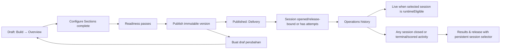

# Tryout gated workflow and publish-boundary refactor plan

Status: implemented in the Tryout workspace; authenticated QA and
server-readiness convergence remain tracked below.

Implementation landed in the lifecycle refactor slice on 24 August 2026. The
server projection, gated builder, contextual actions, published metadata
allowlist, duplicate lineage, session-aware Live/Results surfaces, and focused
contract tests are now in the repository. This document remains the durable
contract and rollout checklist; checked items describe shipped behavior, while
unchecked items are deliberate follow-up work.

This plan supersedes the assumption in the current five-phase workspace that
all phases remain available after a draft is saved. The existing five-phase IA
is still the useful grouping model, but availability will now follow the
Tryout lifecycle and the immutable published boundary.

The product principle is:

> Keep the rich backend state model, but expose only the next meaningful job
> for the current lifecycle state.

## Decisions

These decisions were confirmed for this refactor:

| Decision | Contract |
|---|---|
| Draft editing | A published Tryout is immutable for authoring. To change content, the Kapten creates a new duplicated draft using the existing duplication flow. |
| Draft navigation | Before publishing, show only **Build** and **Review & Publish**. Gate the workspaces in order: **Overview → Configure Sections → Readiness & Publish**. |
| Configure scope | **Configure Sections** is the core authoring step. Its persistent rail contains all seven fixed Sections, and the selected Section contains source choice, CBT/CAT, duration, instructions, shuffle, and CAT settings together. Changing one can immediately explain and invalidate the other without Questions↔Rules ping-pong. |
| Published navigation | After publishing, hide the before-published authoring and review contents. Show only **Delivery → Operations → Results**. |
| Published gates | Delivery is available after publish. Operations remains available once any session is opened/release-bound or has attempts, even after it closes. Live monitoring is separate and requires the selected session to be `runtimeEligible` (`status === active` and an AssessmentRelease is attached). Results unlocks globally when any session is closed or has terminal/scored activity, including a closed zero-activity session with an explicit empty state. |
| Published metadata | A separate **Edit details** action may update only Tryout title and description. Section structure, Questions, Rules, and participant-affecting configuration require **Buat draf perubahan**. |
| Action placement | Remove the top-level **Preview**, **Simpan perubahan**, and **Review & Publish** buttons. Keep the capabilities in the active step footer or contextual panel. |
| Changing a published Tryout | Use **Buat draf perubahan** / the existing duplicate action to create a new editable copy, show its published parent lineage, then return the Kapten to **Build → Overview** in that new draft. |

## Target lifecycle



The arrows describe the first-time path. Completed earlier steps remain
reopenable while the Tryout is a draft, but a later step cannot be entered
until its predecessor is complete. After publish, the authoring path is not a
second tab set: it is available only by creating a new draft copy.

## Visibility by lifecycle mode

The UI must derive one mode from server state and use it consistently in the
header, navigation, route normalization, deep links, and page guards.

| Lifecycle mode | Visible primary areas | Hidden areas | Main CTA |
|---|---|---|---|
| Draft, before the first step is complete | Build → Overview | Configure Sections, Review & Publish, Delivery, Operations, Results | **Simpan perubahan dan lanjutkan** |
| Draft, in progress | Build → Configure Sections | Readiness & Publish, all post-publish areas | **Lanjut ke …** |
| Draft, content ready | Build, Review & Publish | Delivery, Operations, Results | **Terbitkan Tryout** in the final footer |
| Published, no valid session yet | Delivery | Build, Review & Publish, Operations, Results | **Buat sesi** / **Siapkan Delivery** |
| Published, session available/opened | Delivery, Operations | Build, Review & Publish, Results until result gate | **Pantau Live** |
| Published, results gate satisfied | Delivery, Operations, Results | Build, Review & Publish | **Lihat hasil** / **Rilis hasil** when the server gate allows it |

“Hidden” means the area is not presented as an available navigation choice and
its content is not rendered as an alternate tab. If a stale bookmark or query
requests a hidden area, the workspace normalizes it to the nearest allowed
step and explains why.

### Lifecycle orientation

Even when future areas are not navigable, the workspace shows a lightweight
roadmap:

**Build → Review & Publish → Delivery → Operations → Results**

The current area is emphasized, completed areas are marked complete, and future
areas are visibly locked with their prerequisite. The roadmap is orientation
only; it is not a way to bypass the workflow projection.

## Gate contract

The client may show progress, but every gate must be checked again by the
server before the relevant transition or data mutation. A gate has:

1. a stable completion predicate;
2. a human-readable blocker summary;
3. a destination that fixes the blocker; and
4. a next-action label.

### Before publish

| Step | Completion predicate | If incomplete |
|---|---|---|
| **Overview** | Required Tryout identity fields are saved, including a non-empty title. | Stay on Overview; highlight missing fields and show **Simpan perubahan dan lanjutkan**. |
| **Configure Sections** | Every Section has a valid source strategy plus valid duration, instructions, CBT/CAT, shuffle, CAT count/calibration, and source compatibility. All cross-dependent issues are visible in the same selected-Section context. | Keep the user in Configure; show the exact field-level issue and repair target without sending them to a separate Questions or Rules screen. |
| **Readiness & Publish** | The authoritative content checklist has no publish blockers, including title, seven sections, sources, media, duplicates, duration, explanations, assembly compatibility, and CAT readiness. | Keep Publish locked; each blocker links to Configure Sections or the relevant readiness detail. |
| **Publish** | The server re-runs the readiness check and creates the immutable AssessmentRelease. | Show the authoritative error; do not partially expose Delivery. |

The Section rail is the core of Configure Sections, not a separate lifecycle
step. It is available as soon as Overview is complete and shows all seven fixed
Sections. It must use the same readiness predicate as the final review so a
Section cannot appear “Ready” while Review still blocks it.

Section status is intentionally more expressive than a binary flag:

**Not started → In progress → Needs attention → Ready**

**Ready** means the Section will not produce a final Readiness blocker. Every
other status shows an issue count or the next action, for example **PBM —
Question source missing** or **PPU — 2 issues**.

### After publish

| Step | Completion/unlock predicate | If incomplete |
|---|---|---|
| **Delivery** | The Tryout has a published AssessmentRelease. Policy, Sessions, and Participants remain subareas of Delivery. | This state should be unreachable through normal navigation; stale links normalize back to the published default. |
| **Operations** | At least one session is opened/release-bound or has an attempt. This availability is monotonic for the Tryout and remains true after the session closes. | Show **Complete Delivery first** only before any operational history exists. Once available, retain Operations and expose history even without a Live session. |
| **Live monitoring** | The selected session is `runtimeEligible`, derived as `status === active && assessmentReleaseId !== null`. The time window may control participant actions, but not historical Operations visibility. | Show **Live available for an active session** and direct the Kapten to Sessions or Attempts when the selected session is closed. |
| **Results** | Any session is result-eligible because it is closed or has at least one terminal/scored attempt. A closed session with zero activity is valid and shows an explicit empty state. | Show Results globally once any session qualifies; the persistent selector shows per-session readiness and actions without navigation flicker. |
| **Release results** | The existing server release gate passes: immutable release exists, ranking policy is valid, attempts exist, attempts are terminal/scored/release-ready, and policy permits release. | Keep Results visible but disable the action and list the exact blockers. |

Operations and Results use any qualifying session rather than the current
selection, so one upcoming, one active, and one closed session cannot make the
navigation flicker. The selected session still controls Live availability, the
result table, release CTA, and per-session blockers.

## Navigation and routing behavior

### One source of truth

Introduce a pure workflow projection, conceptually:

```ts
type TryoutLifecycleMode = "draft" | "published";

type TryoutWorkflowState = {
  mode: TryoutLifecycleMode;
  currentStep: Workspace;
  completedSteps: Workspace[];
  allowedSteps: Workspace[];
  blockers: Record<Workspace, ReadinessIssue[]>;
  defaultStep: Workspace;
  recommendedNextAction: { href: string; label: string } | null;
  operationsAvailable: boolean;
  liveEligibleSessionIds: string[];
  resultEligibleSessionIds: string[];
  selectedSessionId: string | null;
};
```

The exact type can follow the repository conventions, but the canonical
projection should be produced by the server and consumed by the client. The
same projection must drive:

- phase and subarea rendering;
- active-step selection;
- progress labels and locked-state copy;
- query-string normalization;
- old route redirects;
- footer CTAs; and
- server-action preflight responses; and
- the session selector and per-session Results state.

The client may optimistically show local dirty progress, but it must not
reconstruct lifecycle predicates independently from several cached queries.
Server responses should include `mode`, `allowedSteps`, `completedSteps`,
`blockers`, `recommendedNextAction`, `operationsAvailable`, `liveEligibleSessionIds`, and
`resultEligibleSessionIds` (or an equivalent canonical DTO).

Do not let `?workspace=` or a legacy `/operations` route bypass the projection.

### Query and legacy links

| Incoming request | Draft result | Published result |
|---|---|---|
| No workspace | First incomplete draft step | Delivery default (Policy or Sessions, based on existing data) |
| A later draft step before its predecessor | Nearest allowed predecessor, with an inline blocker message | Not applicable |
| `?workspace=delivery`, `live`, `attempts`, or `results` | First allowed draft step; do not expose post-publish content | Normalize to the matching published area if its gate is satisfied, otherwise the nearest published area |
| `?workspace=basics`, `sections`, `questions`, `rules`, `review`, or `publish` | Normalize to the allowed draft step; legacy Sections/Questions/Rules values map to **Configure Sections** | Normalize to published default and offer **Buat draf perubahan** |
| Legacy `/operations` | First allowed draft step if still a draft | Delivery → Sessions, then Operations only when its session gate is met |
| Existing published Tryout with a stale authoring bookmark | Never render authoring content in published mode | Published default plus **Buat draf perubahan** |

Normalization should preserve the Tryout ID and show a concise reason, rather
than silently dropping the user into an unrelated page.

Results selection is URL-addressable through `?session=<sessionId>`. The
canonical projection validates that ID against the Tryout and owner scope. A
missing, stale, or unauthorized ID normalizes to the recommended eligible
session (or the first session) and shows a concise message; it never leaks
another Tryout’s session or silently changes the user’s context.

## Action placement

The header should retain identity, lifecycle status, breadcrumbs, and the
published/draft mode indicator. It should not contain the three removed top
actions:

- **Preview alur peserta**;
- **Simpan perubahan**; or
- **Review & Publish**.

Place the capabilities where the Kapten is making the decision:

| Capability | New location | Notes |
|---|---|---|
| Save draft changes | Active step footer | Keep dirty-state feedback near the footer; disable while saving and show server errors there. |
| Continue | Active step footer | Label the destination, for example **Simpan perubahan dan lanjut ke Configure Sections**. |
| Preview participant flow | Build or Readiness footer/context panel | Preview the current draft; clearly label it **Preview alur peserta** and do not imply it is the published version. |
| Review readiness | Configure Sections footer and Review & Publish entry | Cross-dependent source/rule blockers remain in the same Section context; readiness details link back to exact fields. |
| Publish | Review & Publish footer | Keep server-backed preflight and confirmation here. |
| Edit published details | Published workspace action/context panel | Separate action allowing only title and description; it must not mutate Sections, Questions, Rules, or AssessmentRelease content. |
| Create editable copy | Published workspace action/context panel | Use explicit copy such as **Buat draf perubahan**; show the published parent and lineage, then open the new draft at Build → Overview. |
| Delivery/Operations/Results actions | Their existing contextual headers, panels, and footers | Do not reintroduce a global action strip. |

The “remove top buttons” change removes their global placement, not the
underlying capabilities. Action labels should distinguish **Simpan perubahan**
for Tryout authoring from **Simpan sesi** for Delivery session setup. The active
step footer is sticky on long authoring pages, and the page title area retains a
persistent **Perubahan belum disimpan** indicator when local state is dirty.

### Unsaved navigation contract

When a Kapten tries to leave a dirty draft step, the workspace must offer three
explicit choices:

- **Simpan dan lanjutkan** — save, then navigate only after the server accepts;
- **Buang perubahan** — discard local changes and navigate; or
- **Tetap di sini** — close the guard and preserve local input.

There is no silent discard and no forward navigation after a failed save. A
failed save keeps the current step active, preserves local input, and leaves the
dirty indicator visible.

## Data and fairness boundaries

No new mutable path may edit a published AssessmentRelease in place. The
existing duplication flow is the intended revision mechanism:

1. duplicate the published Tryout into a new draft identity;
2. preserve the existing published Tryout, release, sessions, attempts, and
   results unchanged;
3. send the Kapten to the new draft’s Overview step; and
4. show the new draft’s parent title, published date, and a link back to the
   published original; and
5. require the normal gated Build → Review & Publish flow for the copy.

Sessions and attempts continue to bind to the immutable published release.
Operations and Results must remain available for historical published data
even when a new draft copy is being authored.

The UI may hide authoring content in published mode, but server authorization
and release/session queries remain the real protection. A client-side hidden
tab is not a security boundary.

Published metadata has one explicit exception: **Edit details** may update the
Tryout title and description only. It must not rewrite Section, Question, Rule,
AssessmentRelease, session, attempt, scoring, or result-release data. Any
participant-affecting or structural change goes through **Buat draf perubahan**.

The Bank Soal editor is the source boundary for authoring:

- Draft Questions and Readiness reference Bank Soal sources, Sets, Pools,
  Blueprints, and CAT Pools; they do not create a second source catalog inside
  the Tryout workspace.
- `folderId === null` is displayed as **Bank soal**. This is source copy and
  terminology, not a new Tryout lifecycle state.
- Stable question and revision IDs remain intact when readiness issues, source
  previews, or direct-repair links are projected into the Tryout UI.
- Readiness issues should preserve stable issue codes and field-level targets so
  the Section rail, step footer, and Review page can link to the exact control
  without guessing from display text.
- Structural edits to published content continue through **Buat draf
  perubahan**. Existing metadata-only published edits remain governed by their
  current server rules and do not make authoring content visible in published
  mode.

This refactor assumes no schema migration and no change to learner Quiz/Tryout
snapshot behavior.

The Bank Soal editor’s release-verified contract is authoritative for this
integration. Its desktop contracts, type checks, lint, build, and verification
are complete; mobile visual/browser QA remains deferred and is tracked
separately from this Tryout lifecycle refactor.

## Critical user-flow scenarios

### First-time draft

1. The Kapten lands on **Build → Overview**. The roadmap shows later phases as
   locked, but does not render their contents.
2. After a successful save, **Configure Sections** becomes available. Its
   persistent rail contains all seven Sections, and each uses one of the four
   status states.
3. The selected Section shows source and rule controls together. Once every
   Section is valid, **Readiness & Publish** becomes available. Review
   confirms the final server-backed checklist and the footer contains Publish.
4. Publish creates the immutable release and switches the workspace to the
   published Delivery mode.

### Cross-dependent source/rule change

If the Kapten changes a Section from CBT to CAT, Configure immediately retains
the Section context, marks incompatible source or calibration fields as
**Needs attention**, and links to the exact controls. The Kapten does not need
to discover a separate Questions or Rules screen, and Readiness remains locked
until both sides pass.

### Multiple sessions

With one upcoming session, one active session, and one closed session:

- Operations remains available because a session has been opened/release-bound,
  even after the active session later closes;
- Live is available only when the selected session is `runtimeEligible`;
- Results is available because the closed session is result-eligible;
- a closed session with zero activity shows an explicit empty Results state;
- changing the Results session selector changes the table and release blockers,
  not the primary navigation; and
- historical Live/Attempt data remains inspectable after a session’s time
  window ends.

### Published details versus structural revision

**Edit details** opens a small metadata form for title and description only.
Saving it does not expose Build or rewrite the AssessmentRelease. To change a
Section, source, rule, or participant-affecting setting, the Kapten selects
**Buat draf perubahan** and sees:

**Draft perubahan · Based on “Tryout SNBT August” · Published Aug 23**

The draft links back to the published original and explains that existing
sessions are unaffected.

### Failed save

When a footer save fails server validation, the user remains on the current
step, local input is preserved, the sticky footer shows the error and retry
action, and **Perubahan belum disimpan** remains visible. Forward navigation is
not performed until the server accepts the current step.

## Actionable implementation todos

### P0 — Required for the lifecycle boundary

- [x] **P0-1 — Define the canonical workflow projection.** Implement a
  server-backed projection for draft/published mode, allowed steps, blockers,
  recommended next action, `operationsAvailable`, `liveEligibleSessionIds`,
  and `resultEligibleSessionIds`. Keep one predicate implementation
  authoritative; do not rebuild it from unrelated client caches.
- [x] **P0-2 — Make navigation lifecycle-aware.** Replace the current
  “all phases are available” presentation with draft-only Build/Review &
  Publish and published-only Delivery/Operations/Results. Keep the persistent
  seven-Section rail inside Configure Sections and show future lifecycle phases
  as locked roadmap items.
- [x] **P0-3 — Make Configure Sections the authoring step.** Remove Sections
  as a separate gated destination. Configure owns the persistent seven-Section
  rail and shows duration, instructions, source strategy, CBT/CAT, shuffle, and
  CAT settings in the selected-Section context. Preserve legacy
  Sections/Questions/Rules deep links by normalizing them to Configure.
- [x] **P0-4 — Enforce step order.** Prevent navigation, direct query links,
  legacy redirects, and browser back/forward restoration from exposing a later
  step. Return the nearest allowed step with a visible blocker explanation.
- [x] **P0-5 — Split draft and published workspace modes.** In published mode,
  do not render authoring or review contents. In draft mode, do not render
  Delivery, Operations, or Results contents.
- [x] **P0-6 — Move actions into contextual footers.** Remove the top Preview,
  Save, and Review & Publish buttons. Preserve save, preview, continue, and
  publish behavior in the active step footer/context panel with loading,
  dirty-state, sticky positioning, and error handling.
- [x] **P0-7 — Add the explicit published metadata action.** Implement
  **Edit details** with an allowlist of title and description only. Verify it
  cannot mutate structural content or regenerate an AssessmentRelease.
- [x] **P0-8 — Make duplication the published-to-draft handoff.** Rename or
  relabel the existing action as **Buat draf perubahan** where appropriate,
  show parent lineage and a link back to the published original, redirect the
  new copy to Build → Overview, and verify that the original release/session/
  history remains unchanged.
- [x] **P0-9 — Separate Operations and Live predicates.** Keep Operations
  available once any session is opened/release-bound or has attempts; derive
  Live availability from the selected session’s `status === active &&
  assessmentReleaseId !== null`. Keep historical Attempts/Operations visible
  after sessions close.
- [x] **P0-10 — Add server-side guards.** Re-run lifecycle and readiness checks in
  every action that saves, publishes, creates a session, opens Operations, or
  releases results. Client navigation must not be the only enforcement. Include
  closed zero-activity sessions in Results with an explicit empty state.

### P1 — Consistency and usability hardening

- [x] **P1-1 — Standardize locked-step copy.** Every blocked step says what is
  missing, why it is unavailable, and provides one CTA to fix it.
- [x] **P1-2 — Align readiness and progress.** Reuse the authoritative review
  predicate and four-state Section status (**Not started**, **In progress**,
  **Needs attention**, **Ready**) in the Section rail, progress indicators,
  footer CTAs, and server preflight responses.
- [x] **P1-3 — Add stable lifecycle orientation.** Show the locked roadmap for
  future phases without making it a bypass path. Add sticky footer behavior and
  the persistent **Perubahan belum disimpan** indicator.
- [x] **P1-4 — Normalize published defaults.** Decide whether the default
  published landing subarea is Policy or Sessions from existing data, then
  preserve that choice across refreshes and legacy routes.
- [x] **P1-5 — Stabilize multi-session Results.** Unlock Results from any
  result-eligible session, retain a persistent session selector, and show
  per-session release blockers without navigation flicker. Persist selection in
  `?session=<id>` and normalize invalid or unauthorized IDs.
- [x] **P1-6 — Define dirty navigation.** On navigation with local changes,
  offer **Simpan dan lanjutkan**, **Buang perubahan**, or **Tetap di sini**;
  never silently discard input or navigate after a failed save.
- [x] **P1-7 — Preserve operational context.** Keep Live refresh/error/retry,
  terminal-attempt precedence, Participants attention projections, and Results
  release gating while changing only their availability boundary.
- [x] **P1-8 — Update terminology and contracts.** Replace stale assertions that
  expect ten peer tabs or global actions; add explicit tests for hidden content,
  duplicate lineage, blocked deep links, combined Configure behavior, the
  published metadata allowlist, and monotonic Operations availability.

### P2 — Validation and follow-up

- [ ] **P2-1 — Add task-based QA.** Test creating a seven-section draft,
  correcting a CAT/source blocker, publishing, creating a session, resolving a
  disconnected attempt, and reviewing/releasing results without the guide.
- [ ] **P2-2 — Add state-matrix regression cases.** Cover one upcoming, one
  active, and one closed session; a closed zero-activity session; CBT→CAT source
  invalidation; draft lineage; `?session=` normalization; Operations history
  after closure; and dirty state after a failed save with local input preserved.
- [ ] **P2-3 — Measure the redesign.** Track time to first publish, navigation
  changes, publish failures, Configure cross-dependency backtracking, time to
  resolve a Live issue, wrong-state actions, and assistance requests.
- [ ] **P2-4 — Evaluate contextual drawers.** Consider a Live/Attempt detail
  drawer after the lifecycle boundary is stable; this is not required for the
  first implementation slice.
- [ ] **P2-5 — Synchronize operational documentation after rollout.** Update
  `docs/tryout-creation-guide.md` to remove the old global-header action and
  separate Questions/Rules descriptions once the new UI ships, while keeping
  screenshots and current-state notes accurate during the transition.

## Acceptance criteria

The refactor is ready for implementation review when:

1. a new draft cannot expose Delivery, Operations, or Results content;
2. a draft cannot enter a later Build or Review step before its predecessor is
   complete;
3. Configure Sections is the only gated authoring step after Overview; its
   persistent Section rail is the user-facing task and legacy Sections,
   Questions, and Rules links normalize there;
4. a CBT↔CAT/source change reports its cross-dependent blocker in Configure,
   and the Section rail uses the four-state model without forcing sequential
   navigation through seven Sections;
5. a published Tryout cannot expose Build or Review content;
6. a stale authoring URL in published mode lands in the published workspace and
   offers **Buat draf perubahan**;
7. Operations remains available after any session is opened/release-bound or
   has attempts, including after it closes; Live availability may change
   independently with the selected session’s runtime eligibility;
8. Results unlocks globally when any session is closed or has terminal/scored
   activity, a closed zero-activity session shows an explicit empty state, and
   changing the selected session does not hide Results;
9. Results selection is addressable with `?session=<id>` and invalid IDs
   normalize safely;
10. unsaved navigation offers Save/Discard/Stay, and failed saves preserve local
   input on the current step;
11. **Edit details** can update only title and description, while structural or
   participant-affecting changes require **Buat draf perubahan**;
12. Results release actions still use the existing server release gate;
13. the three named top actions are absent from the global header;
14. the step footer is sticky, and failed saves preserve local input while the
   dirty-state indicator remains visible;
15. save, preview, continue, publish, edit details, and duplicate remain reachable from
    contextually appropriate footers/panels; and
16. the original published release and operational history remain immutable
    after creating a new draft copy, whose parent lineage is visible.

## Rollout and verification order

1. Land the server-backed workflow projection and its state-matrix tests.
2. Switch navigation and query normalization to the projection.
3. Add Configure Sections, Section statuses, lifecycle roadmap, and mode-specific rendering.
4. Add sticky footer actions, published Edit details, and duplicate lineage.
5. Wire server guards and global multi-session Results eligibility.
6. Run focused authoring, routing, operational, and result-release tests.
7. Update the creation guide and screenshots to the shipped lifecycle contract.
8. Run the full lint/type/build verification and the task-based QA scenarios.

## Implementation notes and verification

- `lib/tryout/workflow-projection.ts` is the pure lifecycle predicate module.
  It is server-composed into the operations DTO without returning AssessmentRelease
  or Bank Soal payloads. Legacy step names normalize to the canonical lifecycle
  vocabulary, and legacy operational evidence keeps Operations monotonic.
- `modules/mentor/KaptenTryoutBuilderPageModule.tsx` now renders only the
  lifecycle mode’s visible areas. Drafts use Overview → Configure Sections →
  Readiness & Publish; published Tryouts use Delivery → Operations → Results.
  Stale workspace values are normalized and locked phases remain visible only
  as orientation.
- Global Preview, Save, and Review & Publish actions were removed from the
  header. Save/continue/preview/publish remain in the sticky draft footer;
  published metadata and **Buat draf perubahan** remain in the published
  context panel.
- Published metadata writes are allowlisted to title and description in the
  server repository. Structural edits continue through duplication and carry a
  `parent` query so the new draft can show lineage.
- Results uses `?session=<id>` and a safe fallback selector. Live is filtered to
  the selected runtime-eligible session. Operations and Results remain globally
  available from qualifying session evidence, including historical/closed data.
- Focused verification currently passes: workflow projection contracts,
  authoring workspace contracts, focused ESLint, and TypeScript. Full repository
  verification should be rerun after unrelated concurrent workspace changes
  settle. Authenticated browser QA for this lifecycle slice remains a follow-up.

One known convergence item is intentionally documented rather than hidden:
the operations DTO does not contain the full editable draft readiness form, so
the canonical projection fails closed for draft readiness and the builder uses
its existing editable-form readiness checks to decide when Configure and
Readiness can be opened. A future server edit/readiness DTO should feed those
same stable issue codes and field targets into the projection so draft routing
and local progress share one server-produced predicate.
