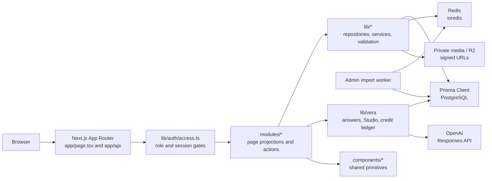

# Architecture

> This page is a code-oriented map. It summarizes boundaries; it does not
> replace the source files that enforce them.

## Runtime shape

PTN Pro is a strict TypeScript Next.js App Router application. Pages and route
handlers live under `app/`; feature projections, forms, and workspace modules
live under `modules/`; reusable UI primitives live under `components/`; and
server-side domain services, repositories, authorization, and infrastructure
adapters live under `lib/`.

### Boundary responsibilities

| Layer | Responsibility | Typical examples |
| --- | --- | --- |
| `app/` | Route composition, metadata, params, and route-handler HTTP boundaries | `app/mentor/tryout/[tryoutId]/page.tsx`, `app/api/vera/...` |
| `modules/` | Role-specific screens, projections, client interaction, and server-action wiring | `modules/mentor/*`, `modules/admin/ai-usage/*`, `modules/vera/*`, `modules/student/*` |
| `components/` | Reusable UI and interaction primitives | `components/ui/table.tsx`, `components/dashboard/reference-dashboard-controls.tsx` |
| `lib/auth/` | Opaque session resolution, role checks, authorized-home redirects, and preview capability gates | `lib/auth/session.ts`, `lib/auth/access.ts` |
| `lib/<domain>/` | Server-only business boundaries and sanitised DTOs | `lib/tryout/*`, `lib/quiz/*`, `lib/vera/*`, `lib/admin/*` |
| `prisma/` | Schema, migrations, and seed/fixture scripts | `prisma/schema.prisma`, `prisma/migrations/` |
| `workers/` | Background processing for operational workflows | `workers/admin-import-worker.ts` |
| `design-tokens/` | Generated theme output from source tokens | `design-tokens/generate-theme.mjs`, `app/generated-theme.css` |

## Request and authorization flow

Most protected pages follow the same shape:

1. The App Router page calls a role-specific function such as
   `requireStudentSession`, `requireTutorSession`, or `requireAdminSession`.
2. `lib/auth/session.ts` resolves the opaque cookie token to an active,
   unexpired, non-revoked `AuthSession` and its user context.
3. `lib/auth/access.ts` enforces the role and onboarding/password state before
   the page loads domain data.
4. A module calls a server-side repository or service and receives a narrow
   projection rather than exposing raw Prisma records to the client.
5. Mutations use the domain action/repository boundary, preserve ownership and
   idempotency rules, then revalidate the affected route.

Admin student preview is a separate capability boundary: it authenticates the
admin actor, resolves a fixed server-side preview subject, and keeps preview
reads and restart actions separate from normal student sessions.

## Infrastructure and deployment

- PostgreSQL is the system of record through the Prisma PostgreSQL adapter.
- Redis is used for server-side Redis access and queue coordination. The
  admin-import worker uses BullMQ-compatible infrastructure.
- Vera answers and Studio documents stream from `app/api/vera/chat` and
  `app/api/vera/studio`. Each run reserves credits before the model is called,
  settles its usage when the stream ends, and names a new session from its
  first answer in `after()`. No background worker is involved. The details are
  in [`docs/vera-ai/README.md`](../vera-ai/README.md).
- Media can be stored behind private object storage/R2 adapters; the app
  resolves signed URLs for allowed consumers.
- `next.config.ts` enables standalone output, MDX page extensions, and narrow
  security headers for the admin preview route family. It also traces the pdf.js
  font and character-map folders into the Vera API routes, since the Materi
  reader loads them by path.
- `pnpm build` generates Prisma, regenerates design tokens, builds Next.js, and
  prepares `.next/standalone/server.js` for `pnpm start`.

Generated artifacts are outputs. Edit their source schema or token files and
regenerate them through the guarded commands documented in
[Development and verification](development-and-verification.md).
