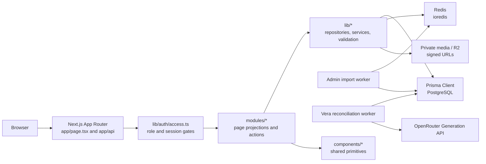

# Architecture

> This page is a code-oriented map. It summarizes boundaries; it does not
> replace the source files that enforce them.

## Runtime shape

Vecalss is a strict TypeScript Next.js App Router application. Pages and route
handlers live under `app/`; feature projections, forms, and workspace modules
live under `modules/`; reusable UI primitives live under `components/`; and
server-side domain services, repositories, authorization, and infrastructure
adapters live under `lib/`.

### Boundary responsibilities

| Layer | Responsibility | Typical examples |
| --- | --- | --- |
| `app/` | Route composition, metadata, params, and route-handler HTTP boundaries | `app/mentor/tryout/[tryoutId]/page.tsx`, `app/api/vera-ai/...` |
| `modules/` | Role-specific screens, projections, client interaction, and server-action wiring | `modules/mentor/*`, `modules/admin/ai/*`, `modules/student/*` |
| `components/` | Reusable UI and interaction primitives | `components/ui/table.tsx`, `components/dashboard/reference-dashboard-controls.tsx` |
| `lib/auth/` | Opaque session resolution, role checks, authorized-home redirects, and preview capability gates | `lib/auth/session.ts`, `lib/auth/access.ts` |
| `lib/<domain>/` | Server-only business boundaries and sanitised DTOs | `lib/tryout/*`, `lib/quiz/*`, `lib/vera-ai/*`, `lib/admin/*` |
| `prisma/` | Schema, migrations, and seed/fixture scripts | `prisma/schema.prisma`, `prisma/migrations/` |
| `workers/` | Background processing for operational workflows and provider accounting | `workers/admin-import-worker.ts`, `workers/vera-ai-reconciliation-worker.ts` |
| `design-tokens/` | Generated theme output from source tokens | `design-tokens/generate-theme.mjs`, `app/generated-theme.css` |

## Request and authorization flow

Most protected pages follow the same shape:

1. The App Router page calls a role-specific function such as
   `requireStudentSession`, `requireTutorSession`, or `requireAdminSession`.
2. `lib/auth/session.ts` resolves the opaque cookie token to an active,
   unexpired, non-revoked `AuthSession` and its user context.
3. `lib/auth/access.ts` enforces the role and onboarding/password state before
   the page loads domain data.
4. A module calls a server-side repository or service and receives a narrow
   projection rather than exposing raw Prisma records to the client.
5. Mutations use the domain action/repository boundary, preserve ownership and
   idempotency rules, then revalidate the affected route.

Admin student preview is a separate capability boundary: it authenticates the
admin actor, resolves a fixed server-side preview subject, and keeps preview
reads and restart actions separate from normal student sessions.

## Infrastructure and deployment

- PostgreSQL is the system of record through the Prisma PostgreSQL adapter.
- Redis is used for server-side Redis access and queue coordination. The
  admin-import worker uses BullMQ-compatible infrastructure.
- The Vera reconciliation worker claims provider attempts from PostgreSQL,
  polls generation evidence when available, and settles or conservatively
  marks unknown provider spend. It never logs prompts, response payloads, or
  provider exception text; the worker's runbook and bounds are in
  [`development-and-verification.md`](development-and-verification.md).
- Media can be stored behind private object storage/R2 adapters; the app
  resolves signed URLs for allowed consumers.
- `next.config.ts` enables standalone output, MDX page extensions, and narrow
  security headers for the admin preview route family.
- `pnpm build` generates Prisma, regenerates design tokens, builds Next.js, and
  prepares `.next/standalone/server.js` for `pnpm start`.

Generated artifacts are outputs. Edit their source schema or token files and
regenerate them through the guarded commands documented in
[Development and verification](development-and-verification.md).
