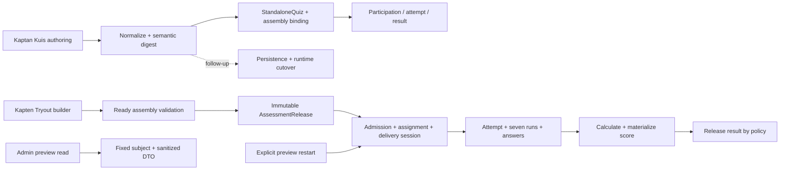

# Assessment lifecycle

> Maintainer map of the assessment path as implemented in the current tree.
> The source files and Prisma schema remain authoritative; this page records
> boundaries, identities, and invariants so a change can be routed safely.

## One mental model

There are two assessment branches. Kuis is the standalone practice flow and
its current versioning work is a contract foundation. Tryout is the released,
operational assessment flow: mutable authoring data is resolved into an
immutable release before delivery. The admin preview branch may enter delivery
only through an explicit restart; a preview read never enters the runtime.

## Stage map

| Stage | Canonical route / UI | Server boundary | Durable identity | Guardrail |
| --- | --- | --- | --- | --- |
| Define Kuis | `/mentor/quiz/[quizId]`, `/mentor/quiz/[quizId]/editor` | `modules/mentor/KaptenQuizDetailPageModule.tsx`, `KaptenQuizEditorPageModule.tsx`, `modules/mentor/quiz-actions.ts`, `lib/quiz/repository.ts` | `StandaloneQuiz`, items/options, and durable assembly binding when used; participation/attempt records are runtime records | Tutor session gate; edits stay behind server actions and repository validation. |
| Kuis version contract | Kuis editor/catalogue/result projections | `lib/quiz/versioning-digest.ts`, `versioning-lifecycle.ts`, `versioning-projections.ts`, `versioning-schedule.ts` | Semantic SHA-256 digest and monotonic `draft → active → superseded` identity | Generated IDs and operational schedule/visibility are excluded from the digest; explicit `null` attempt limits remain meaningful. This is contract-only until persistence/runtime cutover lands. |
| Run Kuis | `/quiz/[slug]/[quizSlug]`, `/quiz/[slug]/[quizSlug]/result` | `modules/quiz/actions.ts`, `modules/quiz/server-data.ts`, `lib/quiz/repository.ts` (`start`, answer, submit, attempt, result operations) | `StandaloneQuizParticipation`, `StandaloneQuizAttempt`, answers, scoring/release state | Availability and attempt state are checked server-side; historical attempts are not rewritten by a replacement definition. |
| Author Tryout and assembly | `/mentor/tryout`, `/mentor/tryout/[tryoutId]`, nested operations | `modules/mentor/KaptenTryoutBuilderPageModule.tsx`, `modules/mentor/tryout-actions.ts`, `modules/mentor/assembly-actions.ts`, `lib/tryout/repository.ts`, `assembly-repository.ts`, `assembly-validation.ts` | `TryoutPackage`, sections/items/options, reusable package/version and source revision identity | Only validated Ready assembly versions can feed a release; package modes and source/media/scope rules are resolved before runtime. |
| Publish to release | Kapten Tryout publish action | `lib/tryout/assessment-release.ts` (`createOrReuseAssessmentRelease`) | Immutable `AssessmentRelease` with content, source IDs/digests, scoring/media, assembly provenance, and publication identity | Tryout must be published; the canonical seven sections must resolve; release creation is deterministic and reuses the same publication identity instead of creating a competing release. |
| Admit and deliver | `/mentor/tryout/[tryoutId]/operations/*`, `/tryout/[tryoutId]`, `/tryout/[tryoutId]/waiting` | `lib/tryout/delivery-repository.ts`, `modules/mentor/tryout-actions.ts`, `participant-repository.ts` | `TryoutAdmission`, `TryoutDeliveryAssignment`, `TryoutDeliverySession` pointing at `assessmentReleaseId` | Management capabilities scope admission/delivery operations; transaction locks protect active-session and assignment transitions; mutable authoring rows are not used as runtime content. |
| Execute attempt | `/tryout/attempt/[attemptId]` | `modules/tryout/participant-actions.ts`, `lib/tryout/attempt-repository.ts` | `TryoutAttempt`, seven `TryoutAttemptTestRun` records, answers, snapshots, integrity data | Attempt and run release identity/digests must match the delivery release; content is snapshotted; answers and sealing are state-checked. |
| Score and release | `/mentor/tryout/[tryoutId]/operations/results/*`, `/tryout/attempt/[attemptId]/result` | `lib/tryout/result-repository.ts`, `lib/tryout/operations-view.ts` | Score breakdowns, `AssessmentScoringState`, `AssessmentResultReleaseState`, participant projections | Calculation requires complete canonical runs and release consistency; incomplete, malformed, rankingless, or contradictory data remains hidden/review-required. |

The reusable package routes under `/mentor/packages/*` and
`/mentor/tryout/packages/*` are not an additional lifecycle branch. Their
layouts return `notFound()` and the current authoring path is the Tryout
workspace plus its nested assembly operations.

## Tryout release and delivery boundary

`AssessmentRelease` is the handoff between authoring and runtime. The release
resolver in `lib/tryout/assessment-release.ts` reads the published Tryout and
the sorted Ready assembly versions, then pins the resolved question revision,
choice, scoring, media, and provenance data. Runtime delivery, attempts,
scoring, and result projections must carry the release identity forward rather
than re-resolving mutable package data.

The operational sequence is:

1. A Kapten validates and publishes a Tryout package.
2. The release resolver creates or reuses the immutable `AssessmentRelease`
   for that publication identity.
3. Admission and assignment operations create or reuse a delivery session
   that points to that release.
4. A learner starts an attempt only from that session; the attempt records the
   release identity and a content snapshot.
5. Seven canonical section runs are answered and sealed.
6. Scoring materializes the attempt result, then the configured release policy
   determines when participant projections may show it.

No runtime stage should draw a random pool, blueprint, or current question
revision from mutable authoring rows. Resolution is deterministic at release
time, and the release payload is the replay/audit boundary.

## Preview is a separate branch

The default admin preview path uses
`lib/admin/student-preview-reads.ts`,
`lib/admin/student-preview-tryout-reads.ts`, and
`lib/admin/preview-read-boundary.ts`. It resolves a fixed safe subject and
returns sanitized DTOs without persistence writes, queue/event work,
notifications, analytics, external writes, or learner-state mutation.

An explicit restart in `lib/admin/student-preview-tryout.ts` is different and
must be named as a mutation in code, UI, and documentation. It:

- finds an eligible published Tryout/session and reuses the latest existing
  `AssessmentRelease`;
- creates or reuses the fixed preview student's active admission;
- supersedes the current assignment and creates a scoped active delivery
  session/assignment with the release pinned;
- writes a `TryoutDeliveryAudit` record and an
  `AdminPreviewTryoutRestart` idempotency record; and
- never creates a new release, attempt, answer, progress mutation,
  notification, or analytics event.

This is a safe retake/delivery setup for preview, not general student
impersonation. A read must never perform the restart as a hidden side effect.

## Locks, idempotency, and capability gates

| Boundary | Protection |
| --- | --- |
| Publish/release | Publication identity and deterministic release reuse prevent duplicate competing releases; release payload is immutable after creation. |
| Admission/delivery | `tryout.delivery.configure`, `tryout.admission.manage`, and related management capabilities scope operations; transaction-scoped locks protect session, admission, and assignment transitions. |
| Attempt runtime | Learner session plus `tryout.attempt.execute` capability is required; release consistency, attempt/run state, and content snapshots protect writes. |
| Preview restart | A transaction-scoped lock plus request-id idempotency row makes the explicit restart retry-safe; preview reads have no write path. |

## Verification map

Run commands through the shared resource guard described in
[`development-and-verification.md`](development-and-verification.md). The
focused contracts map to these boundaries:

| Boundary | Focused checks |
| --- | --- |
| Kuis contract and assembly | `pnpm test:kuis-versioning`, `pnpm test:kuis-assembly-binding`, `pnpm test:kuis-ui-first-workspace` |
| Tryout packages and release | `pnpm test:tryout-package-invariants`, `pnpm test:tryout-release-invariants`, `pnpm test:assessment-release-invariants` |
| Scoring and result release | `pnpm test:assessment-scoring-release-invariants`, `pnpm test:assessment-participant-view` |
| Delivery and projections | `pnpm test:tryout-workflow-projection`, `pnpm test:tryout-live-result-workspaces`, `pnpm test:tryout-realtime-hardening` |

Some checks need disposable PostgreSQL/Redis fixtures. Read each
`scripts/test-*` file before running a database-backed command, and record
whether the evidence covers the contract, persistence, browser surface, or
production build.
