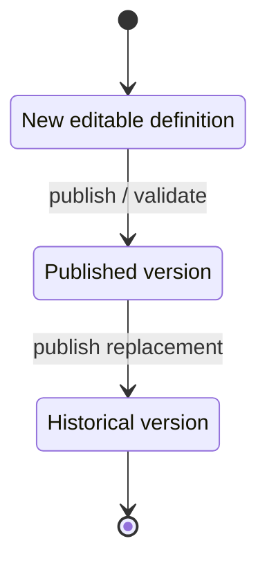

# Domains and data

`prisma/schema.prisma` is the authoritative data model. This page groups the
current aggregates so a maintainer can find the right boundary before editing
or querying a model.

## Domain map

| Domain | Main models and code | Notes |
| --- | --- | --- |
| Account and access | `User`, `AuthSession`, `PasswordResetToken`, `RoleAssignment`, `StudentProfile`, `TutorProfile`; `lib/auth/` | Opaque hashed session tokens, role gates, onboarding/password state, and authorized-home redirects. |
| Enrollment and operations | `EnrollmentHandoff`, `EnrollmentImport`, `EnrollmentImportRow`, dispatch records, `AuditLog`, notifications | Admin-owned enrollment/import workflows and auditable operational commands. |
| Taxonomy and Materi | `ExamProgram`, `ExamEvent`, `Subject`, `Subtest`, `Topic`, `Module`, `ModuleAsset`, `ModuleProgress` | Student content and progress are projected through Materi services; managed documents and media use private delivery boundaries. |
| Question Bank | `QuestionBank`, `Question`, `QuestionRevision`, revision options, folders/categories, calibration rows | Ready/review/retired revision lifecycle and source-digest validation feed Kuis/Tryout assembly. |
| Kuis | `StandaloneQuiz`, `StandaloneQuizVersion`, version-scoped items, `StandaloneQuizParticipation`, `StandaloneQuizAttempt`, `StandaloneQuizAnswer`, `StandaloneQuizStartCommand`, legacy `ModuleQuiz` models | `StandaloneQuiz` is the stable catalogue identity; the active/superseded version owns the student snapshot. Version-scoped participation and attempts preserve historical Kuis results while multiple-choice answer formats remain explicit. |
| Reusable assessment packages | `ReusableQuestionPackage`, package versions/scopes/rules/items | Supports fixed sets, random pools, blueprints, and CAT pools; Ready identity is version-owned. |
| Tryout | `TryoutPackage`, sections/items/options, admissions/assignments, delivery sessions, attempts/runs/answers, releases | Published content is pinned by immutable `AssessmentRelease`; operations read through safe participant projections. |
| Learning signals | topic/subtest performance and recommendations | Feeds learner-facing progress and recommendation boundaries; do not infer product claims from fixture data. |
| Commerce and referrals | `BillingAccount`, `PackagePurchase`, `AffiliatorProfile`, referral attribution and purchase-evidence routes | Succeeded package purchases retain provider reference/evidence and may be attributed to an active Affiliator referral identity. |
| Vera AI | `AiConversation`, `AiMessage`, `AiRequest`, `AiRequestAttempt`, `AiContextToolInvocation`, `AiRequestSource`, `AiContextPack`, `AiQuotaCalendar`, `AiUsageWindow`, `AiRequestUsageReservation`, `AiBillingCorrectionEvent`, policy bundles/audit, lifecycle/export/retention, context/source, artifacts, adaptive practice | Encrypted/digested message envelopes and automatic-tool traces, request idempotency/fingerprints, versioned credit/USD reservations, append-only billing corrections, immutable request evidence, privacy-safe admin aggregates, and lifecycle governance. |
| Media and CMS | `Asset`, `MediaFolder`, announcements, landing sections | Media scope/state and signed preview/thumbnail paths are validated before exposure. |

## Assessment invariants

The assessment model deliberately separates concerns:

- Kuis and Tryout attempts, scoring, and result release use independent state
  axes. A submitted attempt is not automatically a released result.
- Kuis and Tryout runtime scoring reads immutable form/run snapshots and
  materialized answer/breakdown fields; calculation JSON remains audit/replay
  evidence.
- A published Tryout creates or reuses one immutable `AssessmentRelease` for
  the publication identity. It pins content, source identity, scoring
  configuration, media, and assembly provenance.
- Tryout aggregation is valid only after the required canonical section runs
  seal. Malformed, incomplete, rankingless, or contradictory legacy data is
  kept review-required/hidden rather than guessed into a score.
- Preview reads use a fixed safe subject and are side-effect-free: they must
  not create attempts, sessions, external writes, notifications, analytics,
  or learner-state mutations.
- An explicit admin Tryout preview restart is a separate, audited mutation. It
  may create or reuse the fixed preview student's active admission, a scoped
  delivery session/assignment, and audit/idempotency records, but it must reuse
  an existing published `AssessmentRelease` and never create an attempt,
  answer, progress mutation, notification, or analytics event.

### Preview read/restart split

| Operation | Allowed writes | Must never do |
| --- | --- | --- |
| Preview read | None | Create an admission, session, assignment, attempt, answer, progress mutation, notification, analytics event, queue job, webhook, or external write. |
| Explicit Tryout preview restart | Reuse an eligible published `AssessmentRelease`; create or reuse the fixed preview admission and scoped active delivery session/assignment; write audit and idempotency records. | Create a new release, attempt, answer, learner progress, notification, analytics event, or general impersonation state. |

The split is implemented across `lib/admin/student-preview-reads.ts`,
`lib/admin/student-preview-tryout-reads.ts`,
`lib/admin/preview-read-boundary.ts`, and the explicit restart service in
`lib/admin/student-preview-tryout.ts`.

The Kuis versioning layer in `lib/quiz/versioning-*` and `lib/quiz/repository.ts`
uses the states `draft`, `active`, and `superseded`. Its semantic SHA-256 digest
includes versioned definition/question/choice/source identity while ignoring
generated IDs and operational schedule/visibility fields. Explicit `null`
attempts remain distinct from a numeric attempt limit. The default runtime
stores version-scoped items and participations, resolves the active version at
student start, and retains historical attempts under their original version.
`KUIS_VERSIONING_CUTOVER=disabled` is an explicit rollback switch for an
operator; it is not the normal deployment mode. Source/schema coverage is in
`scripts/test-kuis-versioning.ts`,
`scripts/test-standalone-quiz-version-storage.ts`, and
`scripts/test-standalone-quiz-version-runtime.ts`.

## Assembly identity

Reusable package modes are `fixed_set`, `random_pool`, `blueprint`, and
`cat_pool`. Ready versions are server-owned and validate source revision,
content, media, scope, quota, shortage, and (for CAT) canonical calibration
metadata. Pool and Blueprint resolution occurs while creating the immutable
Tryout release; runtime does not draw from mutable authoring data.

Standalone Kuis supports durable Set/Pool/Blueprint assembly identity through
the applied Kuis assembly-binding migrations. CAT Pool is rejected for Kuis;
existing direct/fixed routes remain compatible.

## Vera AI data boundary

Vera AI has both learner-facing and administrator-facing surfaces. The admin
control plane aggregates requests, quota, reliability, incidents, providers,
routing, cost, and policy bundles without returning student conversation text.
Privacy suppression is applied to small cohorts and complementary groups. The
request service tracks idempotency, fingerprints, retry state, provider/routing
metadata, quota reservations, retention, and lifecycle operations. Changes to
these boundaries belong in `lib/vera-ai/` and `lib/admin/ai/`, not in route
components alone.

### Learner MVP and provider boundary

The current Vera learner contract enables `chat`, `review`, `analysis`, and
`route`. `ptn`, `summary`, and `drill` remain explicitly deferred and return a
feature-disabled response; the MVP has no provider-backed artifact-apply
registry. The legacy cohort may select released/owned context, while the
automatic cohort sends no source IDs and uses one closed
`retrieve_released_learning_context` call. Documents and uploads remain
rejected. History is bounded, the context pack is certified before provider
dispatch, and automatic invocation arguments/results are encrypted. The source
of truth is `lib/vera-ai/contracts.ts`, `context-pack.ts`,
`context-tool-contracts.ts`, `context-query-registry.ts`, and
`context-tool-invocation.ts`.

The paid provider path is release-gated. The approved manifest pins OpenRouter
direct routing to the Relace upstream and model
`deepseek/deepseek-v4-flash-0731`, with data collection denied, ZDR requested,
an explicit max-price policy, and a checked certifier artifact under
`certifiers/`. Live transport is not enabled merely by
having a provider module: the live flag, API key, manifest, privacy evidence,
and endpoint metadata must all validate.

### Credit/USD quota ledger

`lib/vera-ai/quota-v2.ts` defines the scheduled `vera_credit_usd_v2` ledger for
`Asia/Jakarta`: chat/review consume one credit, analysis/route consume two;
daily, ISO-week, and monthly windows are persisted through
`AiQuotaCalendar`/`AiUsageWindow`; reservations are linked to each request by
`AiRequestUsageReservation`. The v2 cutover is scheduled for
`2026-09-30T17:00:00Z`; before that instant the policy resolver selects the
legacy `vera_quota_v1` ledger. The v2 monthly guard combines credit limits with
integer USD-micro exposure and monetary-debt state.

Provider cost accounting parses decimal lexemes without JavaScript `Number`,
rounds to integer USD micros once, and preserves reserved/settled/unknown/
released/overrun conservation. `AiBillingCorrectionEvent` is append-only and
records later evidence without rewriting the original request lineage.

`workers/vera-ai-reconciliation-worker.ts` claims due attempts with leases,
polls the generation endpoint when configured, and marks evidence unknown at
the settlement deadline when it cannot be recovered. Its batch, lease,
concurrency, timeout, and backoff bounds are part of the worker contract; it
must not log prompts, provider URLs, or payloads.
