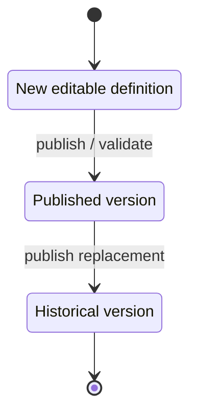

# Domains and data

`prisma/schema.prisma` is the authoritative data model. This page groups the
current aggregates so a maintainer can find the right boundary before editing
or querying a model.

## Domain map

| Domain | Main models and code | Notes |
| --- | --- | --- |
| Account and access | `User`, `AuthSession`, `PasswordResetToken`, `RoleAssignment`, `StudentProfile`, `TutorProfile`; `lib/auth/` | Opaque hashed session tokens, role gates, onboarding/password state, and authorized-home redirects. |
| Enrollment and operations | `EnrollmentHandoff`, `EnrollmentImport`, `EnrollmentImportRow`, dispatch records, `AuditLog`, notifications | Admin-owned enrollment/import workflows and auditable operational commands. |
| Taxonomy and Materi | `ExamProgram`, `ExamEvent`, `Subject`, `Subtest`, `Topic`, `Module`, `ModuleAsset`, `ModuleProgress` | Student content and progress are projected through Materi services; managed documents and media use private delivery boundaries. |
| Question Bank | `QuestionBank`, `Question`, `QuestionRevision`, revision options, folders/categories, calibration rows | Ready/review/retired revision lifecycle and source-digest validation feed Kuis/Tryout assembly. |
| Kuis | `StandaloneQuiz`, `StandaloneQuizVersion`, version-scoped items, `StandaloneQuizParticipation`, `StandaloneQuizAttempt`, `StandaloneQuizAnswer`, `StandaloneQuizStartCommand`, legacy `ModuleQuiz` models | `StandaloneQuiz` is the stable catalogue identity; the active/superseded version owns the student snapshot. Version-scoped participation and attempts preserve historical Kuis results while multiple-choice answer formats remain explicit. |
| Reusable assessment packages | `ReusableQuestionPackage`, package versions/scopes/rules/items | Supports fixed sets, random pools, blueprints, and CAT pools; Ready identity is version-owned. |
| Tryout | `TryoutPackage`, sections/items/options, admissions/assignments, the one delivery session per Tryout, attempts/runs/answers, releases | Published content is pinned by immutable `AssessmentRelease`; operations read through safe participant projections. |
| Learning signals | topic/subtest performance and recommendations | Feeds learner-facing progress and recommendation boundaries; do not infer product claims from fixture data. |
| Commerce and referrals | `BillingAccount`, `PackagePurchase`, `AffiliatorProfile`, referral attribution and purchase-evidence routes | Succeeded package purchases retain provider reference/evidence and may be attributed to an active Affiliator referral identity. |
| Vera AI | `VeraConversation`, `VeraMessage`, `VeraUsageEvent`, `VeraStudioDocument`, `VeraMateriText` | Messages keep their parts and mentions. Usage events hold counts, tokens, credits, and costs, never text. Studio documents keep their markdown, sources, and input. `VeraMateriText` caches the text extracted from a Materi PDF, keyed by a digest. |
| Media and CMS | `Asset`, `MediaFolder`, announcements, landing sections | Media scope/state and signed preview/thumbnail paths are validated before exposure. |

## Assessment invariants

The assessment model deliberately separates concerns:

- Kuis and Tryout attempts, scoring, and result release use independent state
  axes. A submitted attempt is not automatically a released result.
- Kuis and Tryout runtime scoring reads immutable form/run snapshots and
  materialized answer/breakdown fields; calculation JSON remains audit/replay
  evidence.
- A published Tryout creates or reuses one immutable `AssessmentRelease` for
  the publication identity. It pins content, source identity, scoring
  configuration, media, and assembly provenance.
- Tryout aggregation is valid only after the required canonical section runs
  seal. Malformed, incomplete, rankingless, or contradictory legacy data is
  kept review-required/hidden rather than guessed into a score.
- Preview reads use a fixed safe subject and are side-effect-free: they must
  not create attempts, sessions, external writes, notifications, analytics,
  or learner-state mutations.

### Preview reads

| Operation | Allowed writes | Must never do |
| --- | --- | --- |
| Preview read | None | Create an admission, session, assignment, attempt, answer, progress mutation, notification, analytics event, queue job, webhook, or external write. |

The preview is implemented in `lib/admin/student-preview-reads.ts`,
`lib/admin/student-preview-tryout-reads.ts`, and
`lib/admin/preview-read-boundary.ts`. The earlier explicit restart mutation was
removed when a Tryout became a single-session assessment.

The Kuis versioning layer in `lib/quiz/versioning-*` and `lib/quiz/repository.ts`
uses the states `draft`, `active`, and `superseded`. Its semantic SHA-256 digest
includes versioned definition/question/choice/source identity while ignoring
generated IDs and operational schedule/visibility fields. Explicit `null`
attempts remain distinct from a numeric attempt limit. The default runtime
stores version-scoped items and participations, resolves the active version at
student start, and retains historical attempts under their original version.
`KUIS_VERSIONING_CUTOVER=disabled` is an explicit rollback switch for an
operator; it is not the normal deployment mode. Source/schema coverage is in
`scripts/test-kuis-versioning.ts`,
`scripts/test-standalone-quiz-version-storage.ts`, and
`scripts/test-standalone-quiz-version-runtime.ts`.

## Assembly identity

Reusable package modes are `fixed_set`, `random_pool`, `blueprint`, and
`cat_pool`. Ready versions are server-owned and validate source revision,
content, media, scope, quota, shortage, and (for CAT) canonical calibration
metadata. Pool and Blueprint resolution occurs while creating the immutable
Tryout release; runtime does not draw from mutable authoring data.

Standalone Kuis supports durable Set/Pool/Blueprint assembly identity through
the applied Kuis assembly-binding migrations. CAT Pool is rejected for Kuis;
existing direct/fixed routes remain compatible.

## Vera AI data boundary

Vera AI has a learner surface at `/vera-ai` and an administrator cost view at
`/admin/ai` and `/admin/ai/usage`. A student's conversations and Studio
documents are stored as text, and only that student can read them. A usage
event holds the kind, status, effort, model, tokens, credits, USD cost, and
error code, and never any text. The administrator view reads counts, credits,
and costs only, so no prompt, answer, or document text reaches an admin screen.

Read tools return only the student's own data and released or visible learning
content. The rules are in `lib/vera/sources/authorization.ts`, and pinned
sources are checked in `lib/vera/sources/mentions.ts`. Changes to these
boundaries belong in `lib/vera/` and `lib/admin/ai-usage/`, not in route
components alone.

### Provider boundary

Answers come from the OpenAI Responses API through `lib/vera/model.ts`. The
model id is `VERA_OPENAI_MODEL` (default `gpt-6-luna`). The key is
`OPENAI_API_KEY`. Without a key, Vera answers `503 vera_unavailable` before any
work starts. `VERA_MOCK_MODEL=1` swaps in the local stand-in outside production.
The tools and the rest of the Vera contract are in
[`docs/vera-ai/README.md`](../vera-ai/README.md).

### Credit ledger

`lib/vera/ledger.ts` reserves credits before each model call, settles the
usage when the run ends, and checks the day, week, and month windows, the burst
and busy limits, and the monthly USD cap. `lib/vera/usage-tracker.ts` decides
what a run charges, and `lib/vera/credits-shared.ts` holds the prices. Session
titles are recorded with zero credits, so they count toward spend but never
toward requests. The windows are Asia/Jakarta calendar windows
(`lib/vera/windows.ts`). The numbers are in
[`docs/vera-ai/README.md`](../vera-ai/README.md).
