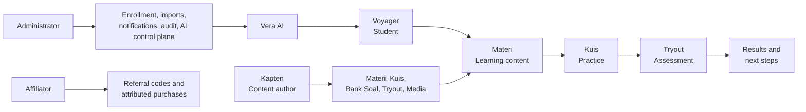

# Vecalss project wiki

> Source snapshot: 23 September 2026 after the automatic-context rollout and
> gate-snapshot migration work. This wiki describes
> the tracked repository state at that snapshot; source code, `PRODUCT.md`,
> `DESIGN.md`, and the Prisma schema remain authoritative when this snapshot
> becomes stale. The shared worktree also contains unrelated uncommitted
> product edits that are intentionally not part of this wiki snapshot.

Vecalss is a Next.js learning academy/LMS for Indonesian students preparing
for PTN admission through Materi, Kuis, Tryout, progress, and human mentoring.
The product uses three role vocabularies: Voyager (student), Kapten (tutor and
content author), and Administrator.

## Start here

- [Architecture](architecture.md) — runtime layers, request flow, and deployment shape.
- [Users, journeys, and routes](user-journeys.md) — role boundaries and the implemented route map.
- [Domains and data](domains-and-data.md) — Prisma aggregates, assessment state, Kuis versioning, and Vera AI boundaries.
- [Assessment lifecycle](assessment-lifecycle.md) — Kuis contracts, Tryout releases, delivery, attempts, results, and preview safety.
- [Development and verification](development-and-verification.md) — setup, guarded commands, current contract suites, and known verification limits.
- [Operations and security](operations-and-security.md) — authentication, preview safety, assessment releases, media, and AI privacy.
- [Current state](current-state.md) — recent completed slices, evidence, caveats, and follow-up work.
- [Vera AI MVP](../vera-ai/mvp.md) — launch features, context boundary, credit/USD budget, provider contract, and rollout checklist.

## Product at a glance

The student loop is intentionally connected to the content-authoring and
assessment workspaces. The Kapten workspace is a CMS-like authoring surface,
not a student-management dashboard. Administrator screens handle operations
and governance, including the Vera AI control plane; the separate Affiliator
workspace handles referral attribution and purchase visibility.

## Source hierarchy

Use the narrowest authoritative source for the question at hand:

| Question | Primary source |
| --- | --- |
| Product purpose, vocabulary, and promises | [`PRODUCT.md`](../../PRODUCT.md) |
| Visual tokens and interaction invariants | [`DESIGN.md`](../../DESIGN.md) and [`docs/design-guidelines/`](../design-guidelines/README.md) |
| Local setup, seed accounts, and environment variables | [`README.md`](../../README.md) |
| Kapten workspace intent and implemented surfaces | [`PRODUCT.md`](../../PRODUCT.md), [`app/mentor/`](../../app/mentor/), and [`modules/mentor/`](../../modules/mentor/) |
| Environment variable names and comments | [`.env.example`](../../.env.example); use [`README.md`](../../README.md) for core setup and seed workflow |
| Persisted entities and constraints | [`prisma/schema.prisma`](../../prisma/schema.prisma) |
| Agent startup, routing, and verification rules | [`_harness/readme.md`](../../_harness/readme.md), [`_harness/routing.md`](../../_harness/routing.md), [`_harness/rules.md`](../../_harness/rules.md), [`_harness/workflow.md`](../../_harness/workflow.md) |
| Durable development decisions and handoff | [`_harness/memory/project.md`](../../_harness/memory/project.md), [`_harness/tracking/`](../../_harness/tracking/) |

## How to use this wiki

Start with the audience and route page for a user-facing question, then move
to the domain/data page for persistence or state questions. Use the
development page before running commands: this repository requires the shared
resource guard for Node, pnpm, Prisma, test, and build processes. Treat the
current-state page as a dated handoff, not as a substitute for checking the
tree.

The wiki intentionally links to existing deep guides instead of duplicating
them. [`docs/tryout-creation-guide.md`](../tryout-creation-guide.md) remains
the detailed Indonesian Tryout authoring guide, and
[`docs/vera-ai/openrouter-free-poc.md`](../vera-ai/openrouter-free-poc.md)
remains the provider POC note.
The paid-MVP contract is in
[`docs/vera-ai/mvp.md`](../vera-ai/mvp.md); the free POC is development-only
and does not inherit the paid provider's privacy guarantees.
