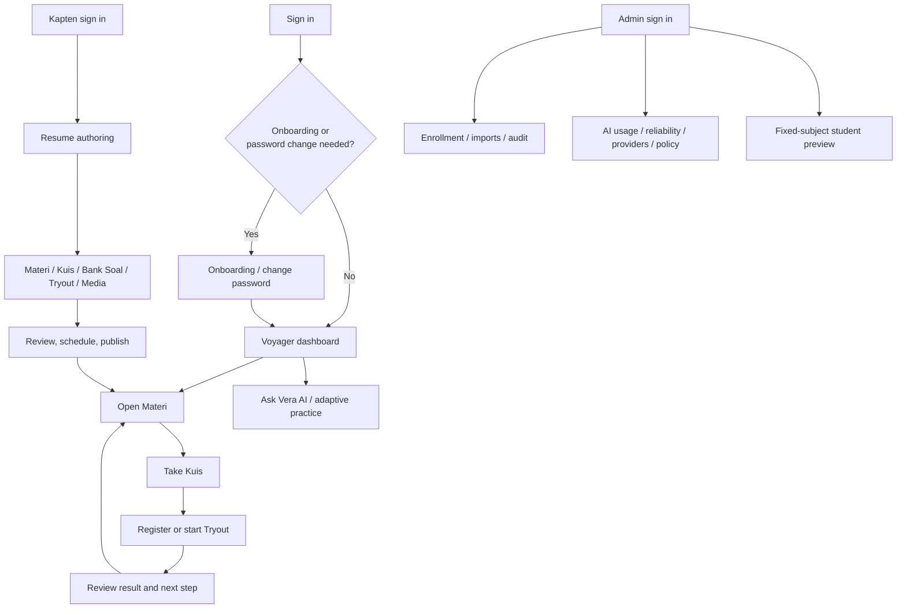

# Users, journeys, and routes

## Role model

| Role | Product name | Primary job | Route boundary |
| --- | --- | --- | --- |
| Student | Voyager | Learn, practise, take assessments, review progress, and use Vera AI | `/dashboard`, `/courses`, `/quiz`, `/tryout`, `/vera-ai`, `/settings`, `/notifications` |
| Tutor/content author | Kapten | Create, organise, review, and publish Materi, Kuis, Bank Soal, Tryout, and Media | `/mentor/*` |
| Administrator | Administrator | Manage enrollment/imports, notifications, audits, student preview, and AI operations | `/admin/*` |

Role names are product vocabulary, not a second authorization system. The
server uses Prisma roles and `lib/auth/access.ts` to enforce access.

## Implemented page routes

The following is the page-level sitemap generated from the current `app/`
tree. API route handlers are listed separately below.

### Public and account lifecycle

| Area | Routes |
| --- | --- |
| Public | `/`, `/about`, `/faq`, `/top-alumni`, `/invite/[token]` |
| Authentication | `/login`, `/forgot-password`, `/reset-password/[token]`, `/change-password` |
| First access | `/onboarding` |

### Voyager learning loop

| Area | Routes |
| --- | --- |
| Home and account | `/dashboard`, `/settings`, `/notifications`, `/notifications/[notificationId]` |
| Materi | `/courses`, `/courses/[slug]`, `/courses/[slug]/[lessonId]` |
| Kuis | `/quiz`, `/quiz/[slug]`, `/quiz/[slug]/[quizSlug]`, `/quiz/[slug]/[quizSlug]/result` |
| Tryout | `/tryout`, `/tryout/[tryoutId]`, `/tryout/[tryoutId]/waiting`, `/tryout/attempt/[attemptId]`, `/tryout/attempt/[attemptId]/result` |
| Vera AI | `/vera-ai` |

`/tryout/[tryoutId]/register` is retained as a route-level compatibility
redirect. Student pages use `requireStudentSession` or the shared session
boundary before loading learner data.

### Kapten authoring workspace

| Area | Routes |
| --- | --- |
| Workspace | `/mentor/dashboard`, `/mentor/settings`, `/mentor/media` |
| Materi | `/mentor/materi`, `/mentor/materi/create`, `/mentor/materi/[materiId]`, `/mentor/materi/subject/[subjectSlug]` |
| Kuis | `/mentor/quiz`, `/mentor/quiz/create`, `/mentor/quiz/subject/[subjectSlug]`, `/mentor/quiz/[quizId]`, `/mentor/quiz/[quizId]/editor`, `/mentor/quiz/[quizId]/results/[attemptId]` |
| Bank Soal | `/mentor/quiz/question-bank`, `/mentor/quiz/question-bank/create`, `/mentor/quiz/question-bank/[bankId]`, `/mentor/quiz/question-bank/[bankId]/editor` |
| Tryout | `/mentor/tryout`, `/mentor/tryout/create`, `/mentor/tryout/[tryoutId]`, and the nested operations/session/participant routes under `/mentor/tryout/[tryoutId]/operations` |
| Reusable packages | `/mentor/packages`, `/mentor/packages/create`, `/mentor/packages/[packageId]`, `/mentor/packages/[packageId]/edit`, `/mentor/packages/[packageId]/use`, and version routes |

Kapten pages use `requireTutorSession`. Legacy Tryout package aliases and the
older operations URLs remain as redirects or compatibility surfaces where the
current workspace owns the canonical route.

### Administrator operations

| Area | Routes |
| --- | --- |
| Core operations | `/admin`, `/admin/enrollment`, `/admin/enrollment/[studentId]`, `/admin/notifications`, `/admin/audit-logs`, `/admin/kapten` |
| Imports | `/admin/imports/[importId]` plus the `/api/admin/imports/*` command and row endpoints |
| Student preview | `/admin/student-preview/[[...slug]]` |
| Vera AI control plane | `/admin/ai`, `/admin/ai/usage`, `/admin/ai/reliability`, `/admin/ai/providers`, `/admin/ai/policies` |

`/admin/ai-usage`, `/admin/ai-policy`, and `/admin/media` are retained as
legacy redirects/compatibility routes. Administrator pages use
`requireAdminSession`; read-only preview reads use the dedicated admin
read-only session boundary.

## API families

The current API tree includes:

- Admin AI projections and governance under `/api/admin/ai/*` and the legacy
  `/api/admin/ai-policy/*` and `/api/admin/ai-usage` routes.
- Enrollment/import/handoff commands under `/api/admin/*`.
- Materi document/progress, notifications, media preview/thumbnail, invite,
  health, and scalability endpoints.
- Vera AI conversations, requests, context, artifacts, exports, lifecycle,
  sources, usage, and adaptive-practice endpoints under `/api/vera-ai/*`.

API handlers should be read together with their `lib/` service and access
boundary. The route name alone is not a permission contract.

## Journey map

